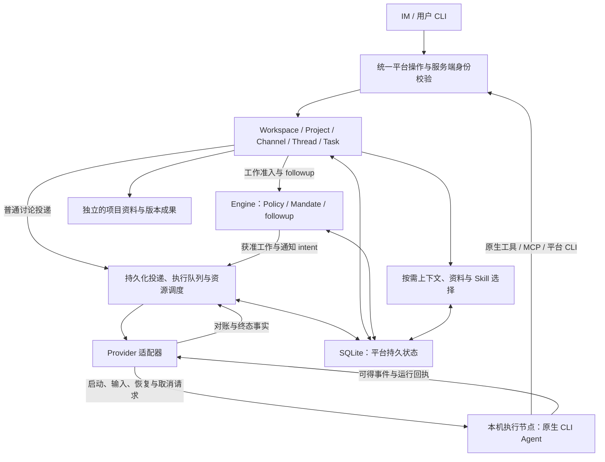

**这是以 IM 为主要界面的本地 Agent 协作工作空间：Workspace 组织多个 Project，项目下的群用于交流，Task 用于组织明确工作。用户可以打开已有文件夹，也可以直接讨论；职责、权限和成果不由目录或聊天窗口决定。**

首版按“本地优先、单用户、多项目/多群”设计，后端保持一个 Go 本地进程与 SQLite，沿用本地原生 CLI Agent 及其认证边界。工作可以是调研、写作、分析、设计或 Coding，不限于软件开发；Agent 的 provider 和模型可配置，不绑定产品开发时使用的模型。

本文描述已采纳的产品目标与验收要求，不表示这些能力均已实现。[现有架构与接口契约](docs/architecture.md)仍使用 `Group/Conversation`；[编排约束](docs/orchestration.md)记录了原有目标及迁移边界。下面的新对象模型需要兼容迁移，不能据此假定既有数据、接口或运行时已经完成转换。

**1. 以 Project 作为长期工作边界，分清群聊、任务与会话。**

| 对象 | 职责 |
|---|---|
| `Workspace` 工作空间 | 组织多个 Project；不是文件夹，也不自动授予跨项目权限 |
| `Project` 项目 | 长期工作、成员、权限、资料与 Task 的边界；可以没有外部目录 |
| `Channel` 群 | Project 下的交流入口，一个项目可有多个群；可见范围受授权约束 |
| `Group` 旧群对象 | 兼容术语；其群聊入口对应目标 Channel，原有成员、权限、资料和任务的项目归属需显式迁移 |
| `Thread` 话题 | 群内共享的话题；与 Task 多对多，不是某个 Agent 的私有上下文或任务分支 |
| `AgentProfile` 模板 | 可复用的职责、Skill、工具、权限需求及运行偏好；模板本身不授予权限 |
| `AgentInstance` 成员 | 项目中的具体 Agent 身份；固定和临时成员使用相同的角色结构，生命周期和可见范围可不同 |
| `Session` 工作会话 | 单个 Agent 的工作上下文，独立于 Task 存在；不等于 provider 原生会话 |
| `Message / Delivery` | 可追溯的消息内容，以及面向接收者的独立投递记录；不等于已读或任务完成 |
| `Task` 任务 | 属于一个 Project 的明确工作，关联目标、约束版本、责任、依赖、授权与验收条件 |
| `Assignment` 执行绑定 | 获准工作与执行者的持续关联，独立于单个 Turn 或单次 Attempt |
| `Turn / Attempt` | Turn 是一轮 Agent 运行；Attempt 关联某任务版本的一次执行尝试及证据，不取代 Assignment |
| `Policy / Mandate` | Policy 是有来源和版本的准入规则；Mandate 是一次获准工作的不可变授权记录，不能替代资源 grant |
| `Submission / Review` | Submission 引用具体版本的交付；Review 是 local-user 对该交付的接纳或拒收决定 |
| `Artifact` 成果 | 可引用具体版本与来源的文件、报告、代码变更、图片等输出；不要求一定来自 Task |
| `ExecutionNode` 执行节点 | 承载目录、工具、执行身份、凭据引用和运行回执的本机或服务器；首版仅执行于本机 |

local-user 指本机的人类操作者，是授权与最终 Review 的主体；这个角色称谓不要求更名既有 `user` 消息身份。

这些关系需要始终保持一致：

- 一个 Project 可以有多个 Channel 和 Task。一个 Thread 可以关联多个 Task，一个 Task 也可以关联多个 Thread；讨论不必创建 Task。
- 同一项目内跨 Thread/Channel 关联任务，不自动授予相关历史、资料或成果的读取权限；跨项目引用和依赖同样需要明确授权。
- **创建者与生命周期所有者分开。** A 拉来的 B 可以继续作为项目成员存在；临时成员退出也不能删除其消息、成果或未决执行证据。
- **协作关系与工作目录分开。** 成员在哪个目录执行，不决定它属于哪个项目、能看哪个群，或在回答谁。
- Task 可关联多个 Turn 和明确绑定的工作上下文，但不能预设 Task、Session、provider 原生会话一一对应。平台持久状态独立保存，Session 替换或压缩不改变任务授权和接纳状态。

旧 `Group` 不能默认等同于新 `Project`，也不能仅改名就视为完成 Channel 迁移。需要显式记录 Project 归属及旧 Group 到 Channel 的兼容映射，保留原群标识、成员、消息与 topic、投递、任务版本、成果引用、幂等记录和执行证据。迁移不能丢失或悄悄扩大原群的可见性与隔离范围。

旧 `Conversation` 是按群、成员、topic 绑定的执行上下文，不是共享 Thread。它到 Session 的兼容关联需要保留原绑定、投递匹配和并发约束；多 Turn 或跨上下文的任务延续必须有显式执行关联与代次校验，不能绕过既有提交围栏。迁移前继续使用既有接口和服务端校验，不声称存储已按新术语重构。

目标职责仍放在同一个本地 Go 进程内，Engine 复用现有 Store、队列与调度，不引入微服务或第二套执行系统：



界面和 Agent 工具共用平台操作与授权规则。平台状态、项目成果和原生 CLI 会话各有自己的保存边界，不靠聊天文本或工作目录推断身份和权限。

**2. CLI 接入采用能力分级；安装、登录和可运行分别检测。**

不要承诺任意 CLI 都拥有完全相同的协作能力。建议支持四种接入方式：

| 接入方式 | 适合情况 | 能提供的能力 |
|---|---|---|
| 原生协议或 SDK | Codex App Server、Claude SDK 等 | 会话、事件、权限交互、恢复，以及厂商特有能力 |
| ACP | 支持 ACP 的 CLI | 复用协议适配，能力按握手结果决定 |
| 非交互执行 | 支持机器可读输出的一次性 CLI | 启动、输出、退出、结果收集；连续性由平台补充 |
| PTY 终端 | 只有交互式终端的 CLI | 保留运行和人工操作入口，自动协作能力明确受限 |

表中是可能提供的能力，所有接入方式的能力标记默认不支持，按所选版本、协议握手或实际运行证据逐项声明。ACP 同样要求协商版本和能力，未声明项视为不支持。[ACP 初始化规范](https://agentclientprotocol.com/protocol/v1/initialization)

适配器对外至少提供：

- 发现安装、检查版本和账户状态。
- 创建或恢复会话。
- 发送输入、订阅事件、中断和关闭。
- 声明是否支持运行中追加输入、工具注入、压缩、用量信息等。

**每个适配器内部处理厂商差异，项目、群聊和队列模块不判断 CLI 名称。** 平台 Session 标识不证明原生恢复、追加输入、工具或压缩能力；能力证据必须绑定所选可执行文件路径、版本和传输方式，不能仅凭版本或账户探针升级能力。

自动检测分四步：

1. **寻找安装。** 检查用户指定路径、应用继承的 PATH、常见安装位置；支持多个版本并让用户选择，不递归扫描整个主目录。
2. **确认版本。** 使用适配器声明的有超时限制的版本探针。
3. **检查账户。** 优先调用厂商提供的无交互状态接口。
4. **确认运行能力。** 根据版本、协议握手和最近实际运行结果更新能力记录。

状态应当分开保存：

| 状态 | 示例 |
|---|---|
| 安装 | 未发现、已发现、版本不兼容 |
| 账户 | 已登录、未登录、不需要登录、未知 |
| 连通性 | 未检查、最近成功、网络异常、额度受限 |
| 能力 | 可恢复会话、可协作、仅终端等 |
| 证据 | 检查时间、探针类型、脱敏后的原因 |

账户接口的既有参考包括 Codex 的 `account/read`（`refreshToken: false`）与 Claude 的 `claude auth status`；适配器实施时须按所选 CLI 版本核对输出和副作用，不把参考文档当作本机已登录或能力已验证的证据。[Codex 账户接口](https://learn.chatgpt.com/docs/app-server#auth-endpoints)、[Claude CLI 文档](https://code.claude.com/docs/en/cli-reference)

**配置文件存在、环境变量存在、ACP 返回登录方式，都不能单独证明已登录。** 状态未知时允许手动连接，自动增员优先选择最近验证可用的配置。自动扫描不应发起付费模型请求，也不应弹出登录或执行登出。

凭据继续交给原 CLI 管理，平台只保存账户引用和脱敏状态，不复制 token 到 Workspace、Project 或群数据，不改写原 CLI 认证和个人配置。还要区分“本机 CLI 登录复用”和“产品自己的登录授权”：商业或托管发布须另行核对并采用厂商允许的授权路径，不能将本地复用直接推广到托管服务。[Codex 官方认证说明](https://learn.chatgpt.com/docs/app-server#auth-endpoints)

**3. 群聊是主要入口，固定与临时 Agent 按授权参与。**

主要入口是**打开已有文件夹**：用户选择或创建 Project，确认目录所在节点及授权范围，再进入项目群。打开目录不等于授予全部读写权限，也不要求先整理或搬迁已有文件。用户同样可以不选目录，直接在项目群讨论或创建非文件任务；模板、Task 和 Git 仓库都不是讨论前提。新群允许先为空，第一条输入可按已启用的用户配置和授权创建临时接待成员。

固定 Agent 与临时 Agent 都包含职责、Skill、工具和权限结构。固定成员面向长期项目工作；临时成员可以仅服务某个 Task、Thread 或 Channel，并限定生命周期及可见范围。职责与协作编排按需组成，不预设固定 CLI/模型组合或每个任务必有独立验证成员。临时、子 Agent 不是绕开授权的另一种身份，也不因由某成员创建就获得其全部权限。协调者是服务端绑定的角色，不能仅靠名字或职责文本冒充。

一个 Agent 发现需要帮助时，可以提出：

> 需要一个熟悉数据分析的成员，检查这份表格；它需要读取资料 A，使用技能 B，并把结论发回当前话题。

平台在已授权范围和容量内完成：

1. 查找已有成员是否能处理。
2. 必要时创建项目内临时成员，记录稳定身份、角色、生命周期、可见范围和授权来源。
3. 根据用户配置、任务需求、已验证的适配能力及授权，从已连接的 CLI/模型中选择满足工具和节点要求的运行配置。
4. 只传递获准读取的相关讨论、加入原因、待解问题和资料引用。
5. 显示加入动作，记录协作归属，再安排回应；超出授权时提出具体请求，超出容量时等待。

目标工具保持小而明确，由同一平台实现：

```text
list_members       create_member
send_message       read_channel
search_history     read_history
create_task        submit_result
publish_artifact   read_artifact
search_skills      load_skill
```

工具调用者、Project/Channel、Session、执行代次和 grants 由服务端执行会话绑定，模型参数不能选择或替换调用身份、所属群/项目及授权。工具及目标资源均按实际 grants 校验，资源路径和任务关联本身不授予权限。

**群聊应像正常团队讨论。** 用户直接发消息，Agent 像团队成员一样主动回应、互相讨论，不要求用户先选择接收方式。群内历史按该群可见范围共享，不默认向项目全部成员开放。

**群消息可见与模型唤醒分开。** 默认路由、仅公开、指定接收者的不同含义保留为内部路由与可选低频控制，不是日常发消息的前置步骤：

- **指定成员**：在输入框通过 `@` 交互选中，或通过成员头像右键菜单选择接收者；两种入口都绑定稳定 member ID，不能只保存显示名。纯正文同名文本不等于结构化提及，不自动改变投递或权限。
- 普通消息：由当前接待成员或明确路由规则选择回应者；仅公开的消息不唤醒模型。
- 多人讨论：协调者按相关性、已授权范围和用户设定的预算选择参与者，记录轮数、续轮及结束条件。
- 其他成员只在下次获调度时按需读取相关增量，不因看见其他 Agent 的消息就互相唤醒。

**聊天决定可直接进入获准工作。** local-user 在讨论后说“可以开始开发了”或同义明确请求时，Agent 结合上下文识别决定、任务和约束变更，自动形成目标与验收条件；同一 Engine 评估可信来源与授权，在本次请求/已启用预授权与资源 grants 的交集内记录 Task/Mandate、自动登记分派，并将行动说明与依据、进度和成果回到原群/话题。用户不必先点“转为任务”、逐项填写授权/分派表单或手动刷新来推进；范围不明或越权时才问一个具体问题。“开始”不是每个任务必需的按钮或硬编码关键词，已启用、有版本和范围的预授权仍允许自主准备。

续轮必须仍在授权和预算内；预算耗尽、问题已解、重复争论或需要人类决策时结束自动讨论，给出摘要或一个明确的人工接管问题。人工可以接管讨论并调整要求，但 Agent 的建议、投票或共识不能变成人类批准。OpenBot 的共享历史与成员独立执行上下文是相关参考，不代表它提供本产品的多人讨论调度。[频道上下文设计](https://github.com/nightly-labs/openbot/blob/f3e3f8ade9c146e96d9d68d65770d2a9126a7856/docs/architecture/channels-and-messaging.md#shared-channel-chats)

IM 保持群列表、时间线和持续可达的输入框，其他入口使用上下文面板：

| 用户入口 | 可查看或操作的内容 |
|---|---|
| 打开文件夹 | 选择 Project、本机目录和授权范围；也可无目录开始 |
| 项目群聊与 @Agent | 切换 Channel、展开 Thread、选择接收者、发起受控讨论或人工接管 |
| 任务详情 | 目标与约束版本、依赖、执行节点、责任、真实进度、暂停/调整及其确认状态 |
| 变更与验证成果 | 具体版本、差异、来源、测试/验证证据、修复关联及 local-user Review |
| 成员 | 固定/临时 Agent 的角色、Skill、工具、权限、可见范围和生命周期 |

界面与错误使用中文，技术标识和详细证据放在可展开详情。只展示服务端可证明的状态，不伪造已读、活动或成功。切换项目、群或面板时保留草稿、未决写入及其原输入和幂等身份，不把关闭详情当作取消执行。

**4. 讨论、授权和执行共用持久化链路，保留各自事实。**

平台需要两类队列，而不是两套执行系统：

| 队列 | 排的是什么 |
|---|---|
| 会话收件箱 | 用户输入、成员提问、回复、获准的 followup 和待处理通知 |
| 工作队列 | 明确任务的执行尝试、依赖等待和资源等待 |

普通讨论可以直接产生 Turn，无须先创建 Task。创建 Task 只记录工作，不自动授权执行；明确任务需要约定结果、验收条件及适用的验证方式。测试、复核或独立验证按任务验收约定或用户启用的 Policy 安排，不是所有聊天或任务的必经环节。

```text
Message 与接收者 Delivery 同事务提交 → 调度目标会话 → CLI 接收回执 → Turn 运行与真实终态
获准的 Task 执行 → 具体版本 Submission → local-user ReviewDecision
按约定或已启用 Policy 提供的验证证据，关联具体版本 Submission 并供 Review 使用
```

验证的必要性、时机及接纳条件遵循任务验收约定或用户启用的 Policy；验证待完成本身不妨碍按约定拒收，接纳仍须满足任务约定或已启用 Policy 要求的条件。

**消息已保存、投递已排队、适配器已送出、CLI 已接受、实际读回或消费、输入已处理、轮次终态、Worker 报告完成、成果已提交、独立验证通过、local-user 接纳，是不同事实。** 不支持可信原生历史证据的适配器不能制造已读回执；CLI exit 0、文字总结和聊天中一句“完成了”都不能冒充真实验证证据或最终接纳。

消息与投递记录在同一个 SQLite 事务中提交，事务内校验成员资格、可见范围和授权，再通知界面。消息、投递、来源事件、任务尝试各有稳定身份；相同幂等 key 和载荷返回原结果，不同载荷冲突。来源身份取自可信元数据，不从正文猜测。编排状态与待执行 intent 也同事务保存，模型调用、文件复制和进程启动在提交后执行。Orca 的 Task/Dispatch 分离、收件箱确认和重放是局部参考；消息与投递原子提交是本产品的要求。[Orca 投递实现](https://github.com/stablyai/orca/blob/9470b4618c7a494254ab9e1ec81c52bd5994256b/src/main/runtime/orchestration/db/messages/role-mailbox-delivery.ts)

**授权与主动协作。** Engine 统一处理来源事件、Policy 准入、Task（参考中的 Ticket）、不可变 Mandate、Worker 报告和 followup 归属，复用现有调度与回执。协调者的模型评估不能越过确定性准入门槛。评估与准入绑定 Policy 版本及候选代次，任一变化都使旧评估失效，不能用过期判断批准工作。

- 预授权来自 local-user 的明确请求，或由 local-user 启用、有版本和范围的书面项目 Policy。记录来源事件、授权者、规则版本、目标、允许动作、数据/目录/工具/节点范围、预算及相关任务，支持审计和追踪。未启用规则时，推断出的工作只作建议，不能自行获得执行许可。
- 项目权限限定“可以触及什么”，Mandate 与预授权限定“本次可以做什么”。在二者交集内，Agent 可主动拆分、创建准备、调查和草稿任务并并行合作，无须逐条重新确认；超出范围则提出授权请求。
- 子 Agent 和临时角色只能获得当前工作可委派范围内的最小权限，并记录父任务、责任和授权关联，不能借拆分任务扩权。Agent 建议、共识、Skill 声明或上下文订阅均不是新授权。
- 协调评估、执行、按需验证与最终 Review 分清职责，不预设每个任务都有独立 Verifier。任务验收约定或用户启用的 Policy 要求独立验证时，须保持其独立性且只提供证据；最终接纳或拒收仍由 local-user 对具体 Submission 执行，Worker、协调者或验证者不能代签。

**区分任务内协作与任务间依赖。** 一个 Task 内可有多个子 Agent 并行调查、起草或验证，记录各自职责、授权、执行关联、报告和证据，仍由该 Task 的责任方汇总；不必给每个子 Agent 另造独立 Task。

独立 Task 之间则记录依赖边、目标/约束版本和就绪条件，通过结构化报告、事件及具体版本 Artifact 传递成果。下游按约定的提交、验证或接纳条件判断依赖是否满足，并保留所用版本与来源；一条聊天消息不能解除依赖。Task 与 Thread 的关联或 followup 订阅只提供获准上下文，不扩大 Mandate；超出当前工作的 followup 应明确交回协调者，不能丢失或暗中接管。

**执行中需求可以变化，但变化必须可追溯。** 需求可以边聊形成；创建任务时绑定目标、约束版本和来源。可信授权的约束或 Policy 变化需记录新版本、来源及受影响任务，使旧计划、候选评估和相关验证结论过时，通知责任方及依赖任务，记录确认并重新规划、验证。Agent 的未获准建议仍只是建议，不能自动覆盖人类要求。

已经在途的工作不会因为平台更新约束就自动停止，也不保证已经读到新约束。后续执行须绑定重新确认且仍获授权的新版本；当前执行须按适配器真实能力投递变更、取得相应确认，或请求取消并等待真实终态。新消息入队、CLI 接受和执行者确认分别记录，不能仅凭通知已发出就将旧结果按新要求提交。已结束任务如需继续，先按当前 Policy 重新校验原 Mandate。人工停止会持久撤回原 Mandate；普通 followup、重试或重新关联不能恢复它，恢复工作需要新的有效授权决定。撤权不等于原执行已经停止。

**测试失败或拒收后，保留修复与复验链。** 将失败/拒收原因及证据、原 Submission/Artifact 版本、目标与约束版本、责任方和状态变化关联起来；修复可在原 Task 的新 Attempt 中进行，也可建立有明确来源和授权的修复 Task。新成果引用原版本及变更，按任务验收约定或用户启用的 Policy 对新版本和当前约束进行适用的复验，原失败和拒收记录不被覆盖。复验或独立验证结论不能替代 local-user 对新 Submission 的 Review；受影响的下游依赖和旧验证结论也要重新核对。

调度与恢复继续遵守原有规则：

- 首版每个 Session/既有 Conversation 同时只运行一轮；同一原生会话也不能被并发重入。同一成员的不同会话能否并行，由适配器能力与资源约束决定。
- 共享写资源互斥，幂等和执行代次/claim token 阻止旧回执修改新运行。授权、资源与跨项目隔离不能靠提示词代替。
- 人类输入、阻塞问题的回复优先，其他任务公平推进；忙碌时默认排队，明确支持追加输入时才能送入当前轮次。
- 暂停调度或请求取消不是 terminal receipt。取消中或 unknown 的执行继续占用容量和资源，直至可信 terminal receipt 或对账证据确认真实终态，才能释放。
- 启动或外部执行结果 unknown 时先对账；重启后恢复待投递消息并核对已有运行，不盲目重复启动。不能通过新建 Task、Assignment、替代会话或修复任务绕过旧未知状态。
- 保留有界事件/帧队列、索引范围读取和关闭排空约束。展示用时间戳/ID 分页不充当消费确认或持久处理位点，不做无界历史扫描或逐原生事件的持久编排扇出。

**5. 将应用状态、项目成果和执行节点分开。**

打开已有文件夹时，平台登记节点、目录与授权范围，不要求把已有项目复制到应用数据区。Project 不等于文件夹或 Git 仓库；一个项目可以引用多个获准目录，也可以完全没有目录。资料按需读取，不把整个目录自动注入所有 Agent。

| 空间 | 用途 | 默认方式 |
|---|---|---|
| 平台私有数据区 | SQLite、会话绑定、消息/投递、授权、运行与验证证据、凭据引用 | 由本地进程管理，与项目成果分开；不存原 CLI 凭据副本 |
| 成员工作区 | 草稿、临时文件、执行输出 | 记录成员、执行与节点归属；不承担任务状态的唯一保存 |
| 项目资料与成果 | 用户资料、共享文档、已发布 Artifact | 按授权可见，可引用具体版本与来源，不自动向所有群开放 |
| 外部已有目录 | 用户授权的代码、文档或其他资料目录 | 明确节点、读写范围和资源归属，文件可留在原处 |

没有文件任务时，用户不必先选目录；CLI 必须有工作目录时，使用平台管理的目录，并明确实际权限。

**共享资料和共同编辑采用不同规则。** 成员从自己的工作区发布成果，记录作者、来源 Thread/Task 或执行、输入版本、成果版本及可用的文件哈希。新版本保留旧版本，消息与依赖引用具体版本；替换共享文档时检查基于哪个版本，冲突时保留双方结果。

共同修改同一资源时，写入串行或明确分配互不冲突的范围。资源身份包含实际节点和目录范围，不能因属于不同 Project 就忽略对同一物理资源的冲突。Coding 并行修改需要时才使用 Git worktree；调研、写作不必经过 Git。

**首版执行于本机，服务器节点是后续能力。** 每次执行需要绑定节点上的目录、工具及版本、执行身份、凭据引用、grants、执行代次和结果 receipt。凭据留在该节点的原 CLI，不能因为连接了服务器就复制本机认证或默认获得远端目录权限。远端能力须另行验证连接、身份、授权、投递与对账契约，不表示首版已经跨机执行。

相同文件夹名、路径文本、分支名或项目名不证明内容已经同步。代码可以通过 Git commit、branch 或 worktree 传递工作版本，但要引用实际提交及必要的差异/快照，不能把可变分支名当成固定成果；通用文件、报告等按版本、哈希和来源引用。跨节点交接须有明确的传递与接收证据，不承诺自动同步。节点收到输入、进程结束、成果发布和 local-user 接纳仍是不同回执；缺少可信终态时保留 unknown 并对账。

独立目录和 worktree 主要解决组织与并发问题，不是 OS sandbox。真正限制访问范围需要 CLI sandbox、操作系统限制或容器支持；不支持时显示实际信任级别，不能靠提示词宣称隔离。

**6. 平台保存可追溯事实，Session 只携带按需上下文。**

| 层次 | 保存内容 |
|---|---|
| 原始记录与引用 | 获准保存的群消息、来源事件、公开输出、工具结果引用、运行回执、任务与验证记录、资料和成果版本 |
| 项目上下文 | 有来源的已确认决定、约束版本、待解决问题和重要资料；仍按群与资源授权过滤 |
| Agent Session | 职责、当前 Thread/Task 引用、待处理消息、相关历史和已加载 Skill |
| provider 原生上下文 | CLI 自己维护的对话、工具过程和压缩状态，能力与可观测性由适配器声明 |

Task、Thread、Artifact 通过来源事件、明确关联和具体版本回溯，原始证据或来源引用独立于 Session 保存。平台不承诺捕获 CLI 的全部内部记录；缺失证据不能靠摘要补成事实。Session 压缩、替换或结束不删除任务、投递、授权和 Review 历史，也不预设平台 Session 与原生会话一一对应。

每次唤醒成员，构造有预算的上下文包：

```text
职责、角色与实际权限
+ 当前话题、任务目标/约束版本和待处理消息
+ 已确认决定、建议与未解决问题的区分
+ 相关摘要及覆盖范围
+ 摘要之后的新消息
+ 获准读取的资料、成果版本和原始证据引用
```

不反复塞入整个群聊、所有 Skill 和全部文件。提供 `search_history`、`read_history` 和资料读取工具，按需回读原始证据；跨 Thread、Channel 或 Project 的链接不绕过读取授权。首版采用关键词和 SQLite 全文检索即可，向量检索不是前提。

压缩采用适配器实际支持的策略：

- 原生自动压缩：由 CLI 处理，平台观察可得结果。
- 支持显式压缩：排入相应会话的独占操作，等待真实完成事件。
- 不支持压缩：按适配器能力建立替代上下文，传入摘要、近期记录和来源引用，保留旧关联与证据。

请求受理不等于压缩完成。Codex 的 `thread/compact/start` 与 OpenBot 的 provider 压缩分工是接口和职责参考，实施时仍须核对所选版本与完成证据。[Codex 压缩接口](https://learn.chatgpt.com/docs/app-server#trigger-thread-compaction)、[OpenBot 压缩归属](https://github.com/nightly-labs/openbot/blob/f3e3f8ade9c146e96d9d68d65770d2a9126a7856/docs/architecture/providers.md#compaction-ownership)

摘要必须注明覆盖的消息/事件范围、来源、决定与建议/争议的区别、生成版本及适用范围。**摘要可能遗漏或失真，必要时回读原始证据。** 压缩期间的新消息留在持久队列，不能被旧摘要覆盖；摘要不能修改任务完成、权限或人类批准状态。

首版由协调者在授权范围内选择性传递经验和资料引用，可将明确选定的经验作为有来源的项目资料保存。不承诺自动提炼长期记忆系统，也不将压缩摘要自动变成跨项目共享知识；临时成员不会自动获得其他群或项目的历史。

**7. 技能库统一管理内容与版本，由适配器负责交给各家 CLI。**

先分清四种东西：

| 类型 | 作用 |
|---|---|
| Agent 模板 | 定义固定/临时成员共用的角色结构、配置偏好和权限需求，不授予实际权限 |
| Skill | 告诉 Agent 如何开展某类工作 |
| Tool / MCP | 提供实际可调用的操作 |
| 项目资料 / 经验引用 | 保存有来源的事实、偏好和历史决定，不等于压缩摘要或自动长期记忆 |

技能库建议兼容 `SKILL.md` 格式，记录名称、说明、来源、版本/哈希、兼容环境和依赖工具。加载方式采用“先展示元数据、选中后读取正文、需要时再读取附属资源”。[Agent Skills 规范](https://agentskills.io/specification#progressive-disclosure)

来源可以包括平台内置、用户安装、本地原生技能目录，以及项目成员生成的技能草稿；来源及项目/群可见范围需要区分。

交给 CLI 时分三种方式：

1. CLI 原生可读取：让它按自己的机制读取。
2. 支持会话级插件或技能目录：提供平台管理的版本快照。
3. 不支持原生技能：提供技能目录检索和正文读取工具。

OpenBot 的原生读取、插件和指令目录分工作为这三种方式的参考，不代表任意 CLI 都支持全部路径。[技能适配设计](https://github.com/nightly-labs/openbot/blob/f3e3f8ade9c146e96d9d68d65770d2a9126a7856/docs/architecture/skills-and-plugins.md#skill-folders-and-mcp-configuration)

需要保持几个规则：

- 原有 `AGENTS.md`、`CLAUDE.md`、`GEMINI.md` 和用户技能继续由各 CLI 按原生规则加载。
- 平台追加的配置尽量限定在当前会话，不改写全局配置。
- 同名技能显示来源，明确解决冲突。
- 当前运行固定使用选中的技能版本，更新从后续运行生效，不能静默替换在途执行的规则。
- 技能声明所需权限不代表获得权限，原生指令文件也不能替代平台授权。
- Agent 可在已授权范围内生成项目技能草稿；保存为全局复用技能是独立操作，不自动扩大可见性或权限。

平台工具保留统一内部实现，外部通过 MCP、原生工具注册或平台 CLI 暴露。Codex 动态工具接口作为实验性、可选适配路径，实施时按所选版本复核，不作为所有 Agent 的必备能力。[动态工具参考](https://learn.chatgpt.com/docs/app-server#dynamic-tool-calls-experimental)

**8. 按新模型渐进迁移，先验收真实协作闭环。**

正常群聊的文本协作闭环先在既有 Group/Conversation 上验收，不以尚未实现的 Project 迁移为前置。新模型迁移仍需明确 Project/Channel 的兼容映射和迁移验收，不重建或丢弃旧群数据。下表保留各阶段目标，不表示迁移必须阻塞群聊修正；现有会话绑定、同 Turn 提交围栏及资源约束在对应迁移获验证前继续有效。

当前正常群聊已在实验性文本范围内完成真实 CLI 闭环验收，限于用户配置且能力已验证的适配器。成员讨论、互邀不必创建 Task；可信来源的明确请求或已启用的规范 `topic_summary` 预授权，经同一 Engine/Policy/Mandate 准入并自动形成目标、验收条件、Task 和 Dispatch，沿用 IntentPass、既有 scheduler 与协调者/Worker 执行，文本 Submission 自动回原群，无需转任务、逐 Task 授权/分派表单或手动刷新。

| 阶段 | 完成内容 | 验收重点 |
|---|---|---|
| 兼容基线 | Workspace/Project/Channel 归属、旧 Group 标识与权限映射、Session 兼容关联 | 原消息、投递、任务版本和成果可追溯，旧群可见性与隔离不丢失、不扩大 |
| 接入验证 | 两个真实本地 CLI，检测、账户状态、会话、事件、平台工具 | 安装/账户/连通性/能力证据独立准确，不改原生配置和认证，不用付费探针 |
| 项目讨论 | 打开已有文件夹或无目录讨论，多群、Thread、@Agent、固定/临时成员及受控多人讨论 | 讨论不强制 Task，按需读取，参与者/轮数/预算可控，跨群关联不扩权 |
| 授权与可靠执行 | Engine/Policy/Mandate、预授权拆分、任务内子 Agent、任务间依赖、持久投递与恢复 | 幂等、会话与资源锁、取消终态、unknown 对账，不重复执行或扩权 |
| 变更与交付 | 来源与约束版本、结构化报告、版本成果、拒收/测试失败后的修复与复验 | 旧评估过时可见，在途变更有确认，新旧版本和验证证据关联，最终由 local-user Review |
| 资料、Skill 与长会话 | 项目成果引用、技能渐进加载及固定版本、摘要、历史检索、适配器压缩 | 不互相覆盖或污染原生配置，摘要遗漏可回读，Task/Thread/Artifact 可回溯 |
| 后续能力 | 更多 provider、通用 ACP、服务器节点及显式版本交接 | 按实际能力逐项验收；标签或配置存在不表示远端执行、同步或新适配已可用 |

发布门槛包括消息/投递原子持久化、幂等重试、重启恢复、跨项目及旧群隔离、会话/资源并发、unknown 与取消保护，以及授权变更和修复复验链。真实 CLI、实际成果和验证证据不能由 mock、CLI exit 0 或文字总结替代；改变已验证性能行为前保留基准证据，维持技能加载回归约束。

**正常群聊文本闭环的验收范围。**

> 用户在既有群中讨论一个想法，Agent 主动回应并互相讨论；无需先创建 Task 或选择接收方式。用户通过 `@` 交互或头像右键指定成员时，投递绑定稳定 member ID，纯正文同名文本不改变路由。
>
> 用户说“可以开始开发了”或同义明确请求后，Agent 从上下文形成目标、验收条件与约束；同一 Engine 核对来源和授权，记录 Task/Mandate 并自动登记 Dispatch，经既有调度与协调者/Worker 链路产出文本 Submission。行动说明与依据、进度和结果自动回到原群，不依赖转任务、逐项授权/分派表单或手动刷新。文本 Submission 与 local-user 对该版本的最终接纳/拒收分开；测试、复核或独立验证按任务验收约定或用户启用的 Policy 安排，不能把提交当作接纳。

文本闭环已验证接纳与受控拒收的持久记录；Review 与回原群的 `platformnotice` 同事务提交，后续摘要能读回真实接纳并区分新稿待审。同 key 重放不重复，同库正常停止/重启后读回一致。Review 通知不自动唤醒模型、重派或授予修复权限；新独立成功不证明旧 unknown 已对账，旧执行仍须可信对账确认真实终态后才能释放资源。

准入预算按 Policy 版本累计；自主准备仅限本话题的规范 `topic_summary` 非空纯文本摘要，最多 8192 UTF-8 字节且不带 Artifact。验收继续覆盖同义请求、有版本和范围的预授权下自主准备、Agent 共识不构成用户许可，以及范围不明/越权时只问一个具体问题。目录写入、Artifact 发布和有来源与授权的自动拒收修复仍待实现与验收，不能声称一句“可以开始开发了”已能修改文件。

后续完整协作验收继续覆盖以下场景：

> 用户打开已有资料文件夹建立 Project，在项目群提出模糊想法；没有 Task 也能讨论。固定助手在已启用的项目预授权内创建临时调研成员和准备任务，发布有来源的报告版本；后续任务通过结构化依赖使用该版本，而不是靠聊天一句话开工。
>
> 执行中用户改变约束，平台记录来源、版本及受影响任务，旧计划与评估标记过时，通知并取得相应确认，必要时等待取消终态。按约定安排的验证发现失败或用户拒收后，修复关联同一目标、原版本与新版本，按适用约定复验后由 local-user 对具体成果决定是否接纳。
>
> 中途重启或压缩上下文后，仍能回溯消息、任务与成果；无法确认的外部执行保持 unknown，先对账，不通过新建任务释放旧资源。同样的讨论与报告流程也可在无外部目录、无 Git 的项目中完成。

参考来源与署名继续保留，并区分参考职责和产品扩展：

- [DeepSeek 的 dsh-superagent-prototype（Superagent）](https://github.com/deepseek-ai/dsh-superagent-prototype/tree/6337fc823ce20251c8de8085948165c81aaa701e)是 Engine、Policy、Ticket、Mandate、Worker 与 followup 的编排参考。[编排文档](docs/orchestration.md)保留固定源码引用及差异；原型依赖 DeepSeek Harness 的运行服务，不等于独立实现了本产品运行时。适配代码须保留 MIT 许可与署名，不能照搬其不符合本产品 unknown/取消回执规则的行为。
- [nightly-labs/OpenBot](docs/openbot-shell.md)是 IM 外壳及相关频道/上下文设计参考；外壳源码来源、署名、NOTICE 和 PolyForm Noncommercial 1.0.0 许可按该文档保留，不声称商业复用已获许可。
- [Paseo](https://github.com/getpaseo/paseo)的运行接口、Orca 的任务尝试与持久投递、SkyTurn 的执行证据经验继续作为局部参考；具体契约按使用版本验证。
- [用户群聊产品讨论示例](https://chatgpt.com/s/cx_6afbaf8778348191bc8c7e54f8c8b74a)说明正常群聊→识别决定/任务/变更→同一 Engine→结果回群的目标，仅作产品讨论来源，不作技术实现证据。

本产品的 IM 多 Agent 讨论调度、动态角色、跨机协作及任务依赖图上的版本成果传递是需要适配和验收的目标，不宣称 Superagent 或 OpenBot 原生提供这些产品能力，也不将参考图或界面视为已经实现。
