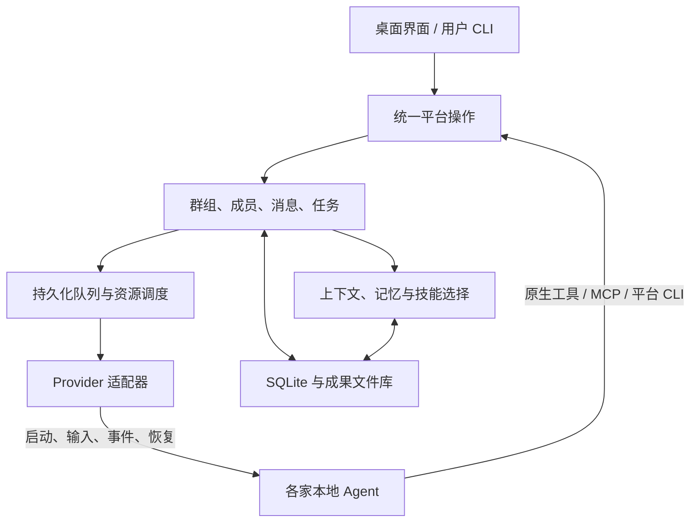

**我建议做成“群组驱动的协作平台”：本地后台进程管理 CLI、会话、消息和资源；用户与 Agent 通过同一套平台操作参与群组。讨论可以先发生，成员按需创建，任务和分支随后形成。**

首版按“本地优先、单用户、多群组”设计。参考分工是：OpenBot 的成员与频道模型、Paseo 的运行接口、Orca 的任务尝试与投递记录，以及 SkyTurn 的执行证据经验。下面是新产品的设计建议。

**1. 先把核心对象分清，避免再次把产品绑在 Coding 上。**

| 对象 | 职责 |
|---|---|
| `Group` 群组 | 成员、讨论、共享资料；不要求预先存在目标 |
| `AgentProfile` 模板 | 可复用的职责、偏好、技能和工具配置 |
| `AgentInstance` 成员 | 当前群组里的具体参与者，可以临时创建 |
| `Conversation` 会话 | 某个成员在某个频道或话题中的独立上下文 |
| `Message / Delivery` | 消息内容，以及向接收者投递的记录 |
| `Task` 任务 | 讨论中形成的明确工作，可有依赖和验收条件 |
| `Turn / Attempt` | 一轮 Agent 响应，或一次任务执行尝试 |
| `Artifact` 成果 | 文件、报告、代码变更、图片等可引用的输出 |

两个关系尤其重要：

- **创建者与生命周期所有者分开。** A 拉来的 B 可以成为群组成员，A 离开后 B 不必被一起关闭。
- **协作关系与工作目录分开。** 成员在哪个目录执行，不决定它属于哪个群组、在回答谁。

模板可以没有，任务也可以没有。新群允许先为空，第一条输入再按用户默认配置创建临时接待成员。

整体可以保持为一个本地进程中的几个模块，不必拆微服务：



界面和 Agent 工具共用操作规则，避免“界面创建的成员”和“Agent 创建的成员”走两套逻辑。

**2. CLI 接入采用能力分级；安装、登录和可运行分别检测。**

不要承诺任意 CLI 都拥有完全相同的协作能力。建议支持四种接入方式：

| 接入方式 | 适合情况 | 能提供的能力 |
|---|---|---|
| 原生协议或 SDK | Codex App Server、Claude SDK 等 | 会话、事件、权限交互、恢复，以及厂商特有能力 |
| ACP | 支持 ACP 的 CLI | 复用协议适配，能力按握手结果决定 |
| 非交互执行 | 支持机器可读输出的一次性 CLI | 启动、输出、退出、结果收集；连续性由平台补充 |
| PTY 终端 | 只有交互式终端的 CLI | 保留运行和人工操作入口，自动协作能力明确受限 |

ACP 本身要求协商版本和能力，未声明的能力应视为不支持。[ACP 初始化规范](https://agentclientprotocol.com/protocol/v1/initialization)

适配器对外至少提供：

- 发现安装、检查版本和账户状态。
- 创建或恢复会话。
- 发送输入、订阅事件、中断和关闭。
- 声明是否支持运行中追加输入、工具注入、压缩、用量信息等。

**每个适配器内部处理厂商差异，群组和队列模块不判断 CLI 名称。**

自动检测分四步：

1. **寻找安装。** 检查用户指定路径、应用继承的 PATH、常见安装位置；支持多个版本并让用户选择，不递归扫描整个主目录。
2. **确认版本。** 使用适配器声明的有超时限制的版本探针。
3. **检查账户。** 优先调用厂商提供的无交互状态接口。
4. **确认运行能力。** 根据版本、协议握手和最近实际运行结果更新能力记录。

状态应当分开保存：

| 状态 | 示例 |
|---|---|
| 安装 | 未发现、已发现、版本不兼容 |
| 账户 | 已登录、未登录、不需要登录、未知 |
| 连通性 | 未检查、最近成功、网络异常、额度受限 |
| 能力 | 可恢复会话、可协作、仅终端等 |
| 证据 | 检查时间、探针类型、脱敏后的原因 |

例如，Codex 可通过 `account/read` 且 `refreshToken: false` 查询当前账户；Claude 当前提供 `claude auth status` 的 JSON 状态。[Codex 账户接口](https://learn.chatgpt.com/docs/app-server#auth-endpoints)、[Claude CLI 文档](https://code.claude.com/docs/en/cli-reference)

**配置文件存在、环境变量存在、ACP 返回登录方式，都不能单独证明已登录。** 状态未知时允许手动连接，自动增员优先选择最近验证可用的配置。自动扫描不应发起付费模型请求，也不应弹出登录或执行登出。

凭据继续交给原 CLI 管理，平台保存账户引用和状态，避免复制 token 到群组数据。身份模块还要区分“本机 CLI 登录复用”和“产品自己的登录授权”：Codex 当前官方对商业或托管服务的 app-server authentication 有明确限制，发布方案需要采用相应授权路径。[官方说明](https://learn.chatgpt.com/docs/app-server#auth-endpoints)

**3. 群组以讨论为中心，动态增员是一项普通平台能力。**

一个 Agent 发现需要帮助时，可以提出：

> 需要一个熟悉数据分析的成员，检查这份表格；它需要读取资料 A，使用技能 B，并把结论发回当前话题。

平台据此完成：

1. 查找现有成员是否已经能处理。
2. 必要时创建群内临时成员，分配稳定身份。
3. 从已连接的 CLI 中选择满足能力要求的运行配置。
4. 给新成员相关讨论、加入原因、待解问题和资料引用。
5. 将加入动作显示在群里，再安排它开始回应。

建议提供一组小而明确的工具：

```text
list_members       create_member
send_message       read_channel
search_history     read_history
create_task        submit_result
publish_artifact   read_artifact
search_skills      load_skill
```

调用者身份、群组和会话由平台绑定，不能让模型在参数里随意指定自己是谁。可用工具也按成员被授予的资源和权限裁剪。

普通增员可以在群组既有授权和容量内自动完成。超出容量时进入等待或提出需求，不让每次讨论都变成确认流程。

频道方面，首版一个群组一个主频道，按需增加话题线程即可。**话题线程不自动等于任务分支**，它可以只是讨论的分流。

还要分开“消息对全体可见”和“启动全体模型”：

- `@成员`：投递给指定成员。
- 普通消息：交给当前接待成员，或根据明确路由规则选择回应者。
- 征求多人意见：启动一轮受控的多人讨论。
- 其他成员下次被唤起时读取相关增量。

这样既能群聊，也能避免每条进度消息唤醒所有成员、互相确认形成循环。OpenBot 的频道也将共享历史与成员独立执行会话分开。[频道上下文设计](https://github.com/nightly-labs/openbot/blob/f3e3f8ade9c146e96d9d68d65770d2a9126a7856/docs/architecture/channels-and-messaging.md#shared-channel-chats)

**4. 通信和任务队列共用持久化机制，但保留不同语义。**

平台需要两类队列：

| 队列 | 排的是什么 |
|---|---|
| 会话收件箱 | 用户输入、成员提问、回复、待处理通知 |
| 工作队列 | 明确任务的执行尝试、依赖等待和资源等待 |

一次普通讨论可以直接产生 `Turn`，无须先创建 `Task`。

消息流程建议是：

```text
保存消息与接收者
→ 创建投递记录
→ 调度目标会话
→ CLI 确认接收
→ 记录对应轮次
→ 收集结果或终态
```

消息和投递记录在同一个 SQLite 事务里提交，先保存再通知界面。每条消息、投递、任务尝试都有自己的 ID，重试沿用相应幂等身份。

需要明确区分：

**已入队、CLI 已接收、轮次已结束、任务已交付、成果已被接纳。**

Orca 的 `Task` 与 `Dispatch` 分离、收件箱确认和重放机制值得借鉴。[投递实现](https://github.com/stablyai/orca/blob/9470b4618c7a494254ab9e1ec81c52bd5994256b/src/main/runtime/orchestration/db/messages/role-mailbox-delivery.ts)

调度规则建议保持简单：

- 首版每个会话同时运行一轮。
- 同一成员的不同会话能否并行，由适配器能力和资源约束决定。
- 人类输入、阻塞问题的回复优先，其他任务按公平队列推进。
- 忙碌时默认排队；明确支持追加输入时才能送入当前轮次。
- 取消后等待实际终态，再释放资源。
- 启动结果不确定时先对账，不能直接重复启动。
- 重启后恢复待投递消息，并核对已有运行；外部执行无法确认时保留“未知”。

讨论可以没有验收条件；明确任务需要约定结果。报告任务可能要求来源与文件，Coding 任务可能要求变更和测试，不能统一用“CLI 返回成功”判定任务完成。

**5. 工作区、共享区和平台控制数据分开。**

建议提供四类空间：

| 空间 | 用途 | 默认方式 |
|---|---|---|
| 平台私有数据区 | 数据库、会话绑定、投递记录、凭据引用 | 由后台进程管理 |
| 成员工作区 | 草稿、临时文件、任务输出 | 归具体成员或执行拥有 |
| 群组共享区 | 用户上传资料、共享文档、已发布成果 | 可引用、可版本化 |
| 外部工作目录 | 用户授权的代码项目或资料目录 | 明确读写范围和执行归属 |

没有文件任务时，用户不必先选目录。CLI 需要工作目录时，平台提供管理目录。

**共享资料和共同编辑要采用不同规则。**

共享资料适合：

- 成员从自己的工作区发布成果。
- 平台记录作者、来源任务、版本和文件哈希。
- 新版本保留旧版本，消息引用具体版本。
- 替换共享文档时检查基于哪个版本，冲突时保留双方结果。

共同修改同一个目录则需要调度约束：同一资源的写入工作串行，或者明确分配互不冲突的范围。Coding 并行修改需要时才创建 Git worktree；调研、写作不必经过 Git。

独立目录和 worktree 主要解决组织与并发问题。真正限制访问范围，需要 CLI sandbox、操作系统限制或容器支持；不支持时应显示实际信任级别，不能靠提示词宣称隔离。

**6. 上下文分层管理，压缩由平台与原生会话共同负责。**

建议保留四层：

| 层次 | 保存内容 |
|---|---|
| 原始记录 | 群消息、公开输出、工具结果引用、资料与成果 |
| 群组知识 | 已确认决定、约束、待解决问题、重要资料 |
| 成员工作上下文 | 职责、当前话题、任务、相关历史与技能 |
| 原生会话上下文 | CLI 内部维护的对话、工具过程和压缩状态 |

每次唤醒成员，平台构造一个有预算的上下文包：

```text
职责与权限
+ 当前话题和待处理消息
+ 已确认决定、未解决问题
+ 相关摘要
+ 摘要之后的新消息
+ 相关资料、成果和历史引用
```

不把整个群聊、所有技能和全部文件反复塞进去。提供 `search_history`、`read_history` 和资料读取工具，让成员补取细节。首版关键词检索和 SQLite 全文搜索就可以工作，向量检索可以后加。

压缩采用适配器声明的策略：

- 原生自动压缩：由 CLI 处理，平台观察结果。
- 支持显式压缩：排入该会话的独占操作，等待完成事件。
- 不支持压缩：创建替代会话，传入摘要、近期记录和来源引用。

Codex 的 `thread/compact/start` 返回仅表示请求受理，完成需要跟踪后续事件。OpenBot 也按不同 provider 区分原生压缩、显式压缩和会话替换。[Codex 压缩接口](https://learn.chatgpt.com/docs/app-server#trigger-thread-compaction)、[OpenBot 压缩归属](https://github.com/nightly-labs/openbot/blob/f3e3f8ade9c146e96d9d68d65770d2a9126a7856/docs/architecture/providers.md#compaction-ownership)

摘要必须带上：

- 覆盖到哪条消息或事件。
- 引用哪些来源。
- 哪些是决定，哪些只是建议或争议。
- 生成版本和适用范围。

压缩过程中到达的新消息留在队列，不能被旧摘要覆盖。摘要也不能直接修改任务完成状态或把讨论意见升级为用户决定。

长期记忆与压缩摘要另外管理。跨群使用记忆需要明确共享范围，临时成员不会自动获得其他群组的历史。

**7. 技能库统一管理内容与版本，由适配器负责交给各家 CLI。**

先分清四种东西：

| 类型 | 作用 |
|---|---|
| Agent 模板 | 定义成员职责和配置偏好 |
| Skill | 告诉 Agent 如何开展某类工作 |
| Tool / MCP | 提供实际可调用的操作 |
| Memory | 保存事实、偏好和历史决定 |

技能库建议兼容 `SKILL.md` 格式，记录名称、说明、来源、版本/哈希、兼容环境和依赖工具。加载方式采用“先展示元数据、选中后读取正文、需要时再读取附属资源”。[Agent Skills 规范](https://agentskills.io/specification#progressive-disclosure)

来源可以包括平台内置、用户安装、本地原生技能目录，以及群内生成的技能草稿。

交给 CLI 时分三种方式：

1. CLI 原生可读取：让它按自己的机制读取。
2. 支持会话级插件或技能目录：提供平台管理的版本快照。
3. 不支持原生技能：提供技能目录检索和正文读取工具。

OpenBot 已采用类似的原生读取、插件和指令目录三种方式。[技能适配设计](https://github.com/nightly-labs/openbot/blob/f3e3f8ade9c146e96d9d68d65770d2a9126a7856/docs/architecture/skills-and-plugins.md#skill-folders-and-mcp-configuration)

需要保持几个规则：

- 原有 `AGENTS.md`、`CLAUDE.md`、`GEMINI.md` 和用户技能继续由各 CLI 按原生规则加载。
- 平台追加的配置尽量限定在当前会话，不改写全局配置。
- 同名技能显示来源，明确解决冲突。
- 当前运行固定使用选中的技能版本，更新从后续运行生效。
- 技能声明所需权限，不代表它自动获得权限。
- Agent 可以生成群内技能草稿；保存为全局复用技能是独立操作。

平台工具同样保留统一内部实现，外部通过 MCP、原生工具注册或平台 CLI 暴露。Codex 的动态工具接口当前属于实验 API，应当作为可选适配路径。[动态工具状态](https://learn.chatgpt.com/docs/app-server#dynamic-tool-calls-experimental)

**8. 实施时先完成一个真实协作闭环，再扩展接入数量。**

推荐顺序如下：

| 阶段 | 完成内容 | 验收重点 |
|---|---|---|
| 接入验证 | 两个真实 CLI，检测、账户状态、会话、事件、平台工具 | 发现、登录、能力状态准确；原生配置正常 |
| 群组闭环 | 建群、临时成员、动态增员、消息和回复 | 无预设任务也能讨论；新成员获得相关背景 |
| 可靠运行 | 持久化投递、任务尝试、取消、资源占用、重启对账 | 不丢待投递消息，不因重启盲目重复执行 |
| 资料与技能 | 工作区、共享成果、技能目录、按需加载 | 版本可追踪，不互相覆盖，不污染原生配置 |
| 长会话 | 摘要、历史检索、原生压缩、替代会话 | 压缩后决定和未完成工作仍可追溯 |
| 更多能力 | 通用 ACP、更多 provider、可选工作分支和远程主机 | 同一能力契约下逐项验收 |

首个验收场景可以直接对应你的使用方式：

> 你提出一个模糊想法，临时助手参与讨论；它创建调研成员，新成员读取相关背景并发布报告；讨论形成明确实现需求后，再创建 Coding 成员并绑定代码工作区。中途重启应用、发生上下文压缩，仍能继续交流，知道哪些消息已处理、哪些工作还没完成、哪些成果已经被采纳。

这个闭环跑通后，主线、分流、合流会成为需要组织执行时自然出现的能力；群组本身始终可以自由讨论。
