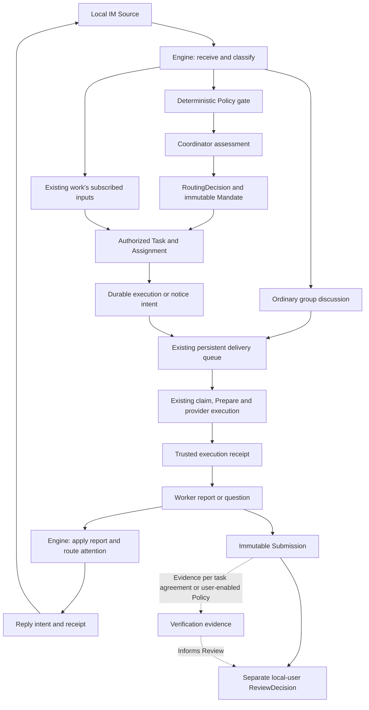

# Conversation-led orchestration

[PRD.md](../PRD.md) is the product authority for the accepted `Workspace → Project → Channel` target. This document retains the coordination direction selected on 2026-11-01 and defines its compatibility migration. Current runtime and persistence remain `Group/Conversation`, one Go process, SQLite, and the existing CLI adapters.

Coordination storage, local Source/admission, and group-bound coordinator configuration exist. With the opt-in `--enable-coordination-roles`, `NewTrustedIntentPass` is wired into the same scheduler to advance already recorded Dispatch requests and Assignments; the bound coordinator `decide_dispatch` → worker `submit_result` composition is implemented. Real local CLI text-result evidence establishes this explicitly admitted baseline only, not acceptance of the natural-chat candidate. Inspect remains diagnostic, not execution authorization; Project migration is not implemented.

The experimental natural-chat candidate, pending integration and product acceptance, connects ordinary chat → runtime-bound `chat_intake/v1` assessment on the same configured member/CLI and verified member-tool adapter → versioned Policy/Mandate admission through the same Engine → automatic Dispatch → the existing scheduler and coordinator/worker chain. Generic member capabilities cannot assess authorization; `RequestWork` and `RequestDispatch` remain local-user-only. `CreateMessage` still routes to the earliest active member when `recipient_ids` is omitted. The flows and interfaces below remain target contracts unless explicitly described as implemented.

The principal reference is [dsh-superagent-prototype at 6337fc8](https://github.com/deepseek-ai/dsh-superagent-prototype/tree/6337fc823ce20251c8de8085948165c81aaa701e). Its implementation provides a domain Engine, versioned admission policy, durable effects, persistent worker inputs, and source-specific replies. Its underlying Sessions, Inbox, Jobs, and Subagents are services of DeepSeek Harness; this repository does not independently implement that runtime. Our Go application adapts the orchestration responsibilities instead of embedding the DSH plugin.

## Product and execution flow

The conversation is the primary interface. Ordinary discussion can produce an Agent Turn without creating a Task. A request becomes authorized work only through a recorded admission decision. Follow-ups for existing work stay with that work unless its executor hands them back.

Product CLI/model selection follows user configuration, task needs, verified adapter capabilities, and authorization. Permanent and temporary Agent responsibilities and collaboration are composed as needed. The coordinator/worker flow below is one composition, not a required Agent lineup for every Task or a claim of new runtime capabilities. Testing, technical review, or independent verification is not mandatory for every chat or Task; its necessity and timing, and the conditions for acceptance, follow the task's acceptance agreement or a user-enabled Policy. Pending verification alone does not bar rejection as agreed; acceptance must still satisfy the applicable conditions.

The initial Source is the local IM. **Reply destination** means the authorized response destination, called Channel in the pinned DSH reference; it is not the PRD's Project Channel. Local replies use the existing group/topic scope; Project Channel mapping is not yet implemented.

GitHub and Feishu adapters may later implement the same contracts; adding their descriptions or UI labels does not enable them or authorize external messages.

## Experimental text scope

`GET/PUT /api/v1/groups/{group}/coordination/chat-policy?topic_id=...` reads or configures one group/topic's Policy and cumulative `max_admissions` budget per revision. PUT requires `Idempotency-Key` and `expected_revision`. Preparation requires `enabled=true`, `allow_preparation=true`, and `preparation_scope_kind=topic_summary`; the server fixes Task goals and acceptance to summarizing that topic's saved messages. GET exposes the canonical rule, configuration source, and `preparation_supported`; legacy free-text rules are not upgraded, and new PUTs cannot choose an authorization message ID. Disabling Policy does not cancel existing pending/inflight work.

Runtime binds `source_kind/source_id` and `purpose=chat_intake/v1`; `authority_evidence_verified` reports source, responsibility, and scope checks, not error-free intent interpretation, itemized human approval, or acceptance. Platform `sender_id=user` is not human permission. Missing legacy evidence stays `unknown` without blocking existing Task/Submission access or Review.

Chat `text_submission` carries no Artifact references; file tools, Artifact publication, and external actions are outside this path. `topic_summary` submissions require nonempty UTF-8 text of at most 8192 bytes; structural checks do not prove semantic quality.

**Ordinary discussion candidate.** When the local user omits recipients, the earliest active member is targeted if one exists; an explicit empty list is public-only, and explicit selections target those stable member IDs. Structured `@` and avatar selection bind IDs; plain text never changes recipients. A handoff starts from a recorded local-user chat command, not merely `sender_id=user`. Actions require a persisted assessment on the live server-bound `chat_intake/v1` claim, delivery, and candidate. The current owner at the head can advance the path; the caller cannot choose the source, actor, group, topic, or return route. Coordination role Turns cannot use this path.

- One path per originating message stays in its group/topic. The Store caps it by default at two invitation hops and four targeted wakes, excluding the original user's deliveries. Each invitation targets one active member and reserves a return; loops and forks are not allowed. The legacy and structured tools share the per-Turn limits of one directed and one public-only publication after assessment.
- An answer returns to the inviter of the exact invitation; a relay unwinds in reverse order. If the inviter has left, the answer stays public without a wake or replacement recipient and the path ends. The root member can post a public-only summary after the root answer, or without inviting anyone. Every step is an ordinary member-authored message in the same group/topic. A delivery schedules attention, not a read or execution receipt, and the handoff does not authorize work.
- Legacy directed messages keep their visibility and receipts. Only a verified local-user-chat-triggered Turn can use the legacy directed send, targeting a single active same-group member; a legacy member-triggered Turn gains no structured return or further wake. With the discussion schema present, the timeline and exact message read expose saved invitation, reply, and summary links without inferring them from prose or deliveries. A summary without an invitation remains visible without a handoff badge.

The Store/domain and timeline presentation are source candidates. Startup schema registration, runtime tool/adapter integration, and real local CLI and browser acceptance are still pending; Store exercises with the test schema establish persistence and scope, not live collaboration. Design provenance is the pinned [intake.ts](https://github.com/deepseek-ai/dsh-superagent-prototype/blob/6337fc823ce20251c8de8085948165c81aaa701e/src/core/intake.ts) for source/thread correlation and [notices.ts](https://github.com/deepseek-ai/dsh-superagent-prototype/blob/6337fc823ce20251c8de8085948165c81aaa701e/src/app/notices.ts) for relating a result to the question it answers. This slice uses existing group messages and deliveries, not the reference's Session notice runtime or implementation code.

## Domain mapping

| Reference concept | Go application meaning | Required distinction |
| --- | --- | --- |
| Source / Trigger | A source-owned immutable event and its verified metadata; local message events reference the existing Message | A Trigger can also be a command or system fact. Do not duplicate message text or infer identity from its body. |
| Thread | Shared topic within a target Project Channel; legacy identity is group/topic | Existing Conversation is private to one group/member/topic. It is not the shared Thread. |
| Channel (DSH reference) | Reply destination for an authorized response | Not the target Project Channel, a Pi/Codex provider, a model, or a Session. |
| Policy / Eval | Deterministic eligibility followed by a version-bound assessment of one Thread batch | Model judgment cannot bypass the gate, choose the caller, or grant permissions. |
| Decision / Mandate | RoutingDecision plus immutable authority, origin, scope, strength, and policy revision | RoutingDecision is not the existing deliverable ReviewDecision. Scope text is not a filesystem grant. |
| Ticket | An existing Task with explicit coordination and Mandate records | An ordinary or manually recorded Task does not automatically authorize execution. Do not create a second unrelated task system. |
| Assignment | A durable executor binding for authorized work, independent of physical Turns | Current TaskAttempt is an immutable generation/evidence association, often bound to one Turn. It must not silently become a multi-turn Assignment. |
| Subscription / Input | Work-to-Thread follow-up ownership and durable inputs | A subscription supplies context, not wider authority. Delivery remains the physical member-conversation delivery record. |
| Report / Attention | Structured progress, outcome, or one concrete question | A report of readiness creates or points to a Submission; it never accepts its own result. |
| Effect / Outbox | A durable intent and its independently tracked reply receipt | An intent is not proof of execution or external delivery. |

During compatibility, coordinator bindings and execution conversations remain group-isolated. A coordinator is a server-bound role, not a member name or free-form responsibility string. This adapts the reference's one-repository main Session to multiple isolated groups. Worker roles remain bound to their Assignment and live execution scope.

An Assignment may eventually span multiple Turns. That requires an explicit, reviewed association and generation check. Existing same-Turn submission fences continue to apply until that association is implemented; no adapter may weaken them merely to obtain continuity.

## Modules and their interfaces

Runtime is the composition root. It owns the process lock, Store, private roots, adapters, HTTP, startup, and ordered shutdown. It contains no admission rules.

Engine is the only writer of the new coordination aggregates. Its small role-scoped interfaces receive commands and adapter facts. Intake, admission, follow-up ownership, work transitions, and replies are internal parts of the same module, rather than parallel orchestration services.

| Caller | Interface responsibilities |
| --- | --- |
| Verified Source | Receive a source event, associate its Threads, report an external close |
| Local user | Explicitly request or attach work, stop authorized work, resolve an attention request, review a concrete Submission |
| Bound coordinator | Assess a current candidate, record a permitted decision, route work or a follow-up, send an allowed reply |
| Bound worker | Report on its Assignment, acknowledge only evidenced inputs, submit a deliverable, request help, hand back an unrelated follow-up |
| Runtime adapter | Report start, input delivery, terminal receipts, and reconciliation facts for its bound execution generation |

The Store supplies a transactional seam through which one Engine command changes all affected records and queues its intents. Extract and reuse existing in-transaction helpers; do not call public Store operations that open a second transaction from inside an Engine transaction. File copies, model calls, native process launches, and network writes happen after commit.

Policy is deterministic and versioned. Assessment proposes a decision under a captured Policy revision and candidate generation. A stale result cannot accept work after either changes. Explicit local-user requests, including contextually clear conversational requests, are an authorization source, not a requirement to submit an admission form. Work inferred from Agent discussion remains observational unless an enabled, scoped, versioned written local-user rule authorizes it; that rule can permit autonomous preparation without a new “start” per task. Trusted intake must carry the actual source and authority into the same Engine, not expose local-user-only `RequestWork` or `RequestDispatch` to ordinary members as a user-impersonation shortcut.

In-flight constraint changes and Mandate revocation below remain target contracts; this candidate's chat Policy changes fence new admissions but do not implement those controls. A trusted Policy change invalidates stale evaluations and notifies the work it affects. An ended Task's coordination may resume only after its original Mandate is revalidated against the current Policy. A human stop persistently withdraws that Mandate: ordinary follow-up, attach, or retry cannot restore it; newly authorized work requires a new decision and Mandate. This authorization transition does not release an uncertain native Turn's resource claims.

Assessor and Executor are different responsibilities. The assessor decides whether and where work belongs. The executor uses the existing scheduler, claim fencing, provider adapters, and receipts to perform it. There is one persistent execution queue, not an additional scheduler hidden behind Engine.

## Persistence and recovery contracts

- Source event identity is stable and idempotent. Replaying an accepted event cannot create another Task, Mandate, Assignment, or acknowledgement.
- A Thread has at most one current evaluation generation. Events that arrive while assessment runs remain available for the next batch.
- Domain changes and their durable intents commit together. Workers run intents after commit with bounded scans and backoff. A generation comparison prevents an old completion from deleting a newer payload under the same effect key.
- Effects are at-least-once scheduling. Local replies reuse the existing message transaction and idempotency receipt. Any external reply destination must supply its own idempotency or reconciliation behavior; the queue alone cannot promise external exactly-once delivery.
- Existing deliveries remain the source of execution scheduling. Effects may create a stable delivery or a coordinator notice; they must not launch a second CLI for an already claimed or uncertain delivery.
- Input queued, adapter accepted, demonstrably consumed, processed, and task accepted are distinct facts. Pi/Codex paths without trustworthy native-history evidence must not manufacture an input read receipt.
- Human follow-up ownership is explicit. Context-only subscriptions neither widen a Mandate nor resume stopped work. A worker can hand back a message, but another owner must not lose it as a side effect.
- A structured question is a single attention record with a stable identity. Routine progress updates do not wake every member or append repetitive IM notifications.

All migrations remain append-only. Existing durable messages, idempotency receipts, Task versions, artifact references, and claim evidence are retained. Timestamp/ID cursors remain display pagination; a durable message sequence, where available, is the basis for commit-position processing. No cursor is silently reinterpreted as another kind of acknowledgement.

## Project migration and rollback

Implement the [ownership contract](architecture.md#project-compatibility-migration) in separately reviewable slices. Each slice must close historical backfill and every corresponding new-write path transactionally before dependent APIs or UI are enabled. New and legacy entry points share transaction helpers and one authorization/idempotency authority, not a background synchronizer or a second Engine, Store, or queue.

| Slice | Required closure |
| --- | --- |
| Group ownership | Backfill each Group into its distinct Project and Channel in the default Workspace. Legacy `CreateGroup` must create its Project and Channel in the same Group transaction; identical key/payload replay must reuse the saved mapping. Historical backfill alone is insufficient. |
| Task ownership | Later, backfill Project and origin-Channel associations and maintain them in every Task insertion transaction, including RequestWork. Preserve legacy group/version/provenance authority; explicit Thread links grant no access. |
| Member ownership | Later, map each old member independently and maintain every member-creation path in the same transaction. Do not merge same-name/provider members or enable cross-Channel instance reuse. |
| Session compatibility | Later, backfill immutable explicit 1:1 Conversation-to-Session bindings and maintain every Conversation insertion in the same transaction. Preserve group/member/topic, delivery matching, uniqueness, and concurrency. This is neither a final product 1:1 rule nor evidence of native resume. |

Mappings and migration version must commit atomically. Missing or inconsistent mappings fail closed; reads must not silently repair them, and background backfill must not expose partial ownership. Channel-independent Project Tasks require a later compatibility slice; do not simulate them with hidden Channels or Groups.

Apply append-only, versioned SQLite migrations under the existing startup lock, before scheduler activity or new business writes. Do not rewrite old records or published migrations, rename/rebuild legacy tables, or weaken foreign keys, grants, claim, or provenance constraints. The existing schema gate makes an old binary reject a newer schema; API compatibility does not imply binary downgrade compatibility.

Before migration, follow existing drain/receipt rules and take a consistent SQLite backup accounting for WAL. Record schema version, database hash, exact binary/source version and binary hash, and runtime/external execution state. Preserve unknown executions and claims.

Restore that snapshot with its old binary only if no business writes or external effects occurred after the snapshot; retain the failed/new database as evidence. Otherwise preserve all subsequent facts and forward-repair/reconcile. Never erase unknown outcomes or claims, or force unsafe replay. There is no automatic downmigration; never delete migration rows to bypass the schema gate.

Implementation acceptance covers empty and historical databases, atomic migration failure, reopen, idempotent replay and new-write closure, isolation including two same-name old groups, unknown/cancellation protection, Session exclusivity, resource locks, and late-receipt generation fences.

Before altering established performance paths, record a comparable baseline for the exact base, environment, and data scale. Assess affected migration and creation costs; preserve bounded/indexed reads, transaction integrity, and unchanged hot paths where possible. Keep performance comparisons scoped to affected paths.

## Safety and compatibility retained from this application

The reference is research code. Its product-specific choices do not replace these established contracts:

1. A business stop requests cancellation; it does not prove that a native process or background operation stopped. Unknown and cancel-requested executions retain capacity and resource claims until an authoritative terminal or reconciliation receipt.
2. Restart does not blindly create a replacement execution for an uncertain start. A new Assignment or a recovery prompt cannot erase old external uncertainty.
3. Task submission and acceptance remain separate. Worker readiness, a merged external Thread, native exit zero, or an ended Assignment cannot fabricate a local-user ReviewDecision.
4. Group isolation, runtime-bound tool identity, same-transaction authorization fences, and explicit resource grants remain mandatory. Prompt scope is explanatory text, not an operating-system sandbox.
5. CLI credentials remain with their original CLI. Installation, account state, connectivity, and supported capabilities remain independent evidence. A stable platform Session identifier does not imply native resume, steering, or compaction support.
6. Bounded event/frame queues, SQL range scans, shutdown drain, and the existing skills allocation regression gate are preserved. No per-native-event durable-effect fan-out or unbounded history scan is introduced.

In particular, do not adopt the reference's timeout-based worker-slot release while background subagents may still run, or its automatic restart of interrupted work, as substitutes for this application's receipts.

## IM interaction contract

The UI uses a conversation list, a central chronological message timeline, and a composer that remains reachable. Members, Tasks, deliverables, search, and conversation details are contextual panels or drawers. They do not replace the conversation with a dashboard or a collection of administrative pages.

The target everyday path is normal group conversation: Agents proactively respond and discuss with one another within relevance, authority, and budget bounds. When local-user says “可以开始开发了” or makes an equivalent explicit request, Agents interpret the conversation's decisions, tasks, and constraint changes to derive goals and acceptance criteria. The same Engine evaluates the trusted source and authority; within the intersection of the request/enabled preauthorization and resource grants, it records the source, Task and Mandate, and automatically registers Dispatch for the existing execution path. Actions and their basis, progress, and results return to the originating authorized group/topic.

Choosing a delivery mode, clicking “转为任务”, filling itemized authorization/dispatch forms, or manually refreshing must not be prerequisites. Unclear scope or a request beyond authority calls for one concrete question; Agent suggestions or consensus are not user permission. Enabled, scoped, versioned preauthorization still permits autonomous preparation. “Start” is not a required per-task button; keyword/regex matching or relabeling existing controls cannot replace contextual intent and authority assessment.

Use the existing charcoal, warm-white, and vermilion tokens. Display the local author as the user and a member by its real known identity. Put technical identifiers and detailed execution evidence in expandable details. Keep source identity separate from the selected Agent provider.

Panel or conversation changes must preserve pending and uncertain mutations, their original input, and their idempotency keys. Hidden, unused reads may stop; shared roster data still needed by the active composer must remain available. Closing a panel must not cancel a submitted write or change the chosen recipients.

Message visibility and wakeups stay separate. Default routing, explicitly public-only, and explicitly selected recipients retain their compatibility meanings as internal routing and optional low-frequency controls, not a required pre-send mode picker. To address a member, select an `@` suggestion in the composer or choose a recipient through the member avatar's right-click menu; both bind stable member IDs, not display names. Plain text containing the same name is not a structured mention and does not alter delivery or authority. Receipts distinguish saved, accepted by the CLI, terminal, submitted, and accepted result; no unproven read or typing indicator is shown.

Task and attention cards require durable typed references and real actions. Their immutable event history is separate from any clearly labeled current-state projection. Until the backend supplies those references, show the actual Task in a contextual panel rather than inventing an event in the chat.

Unread counts, last-message previews, coordinator badges, external-source labels, and activity indicators require authoritative data. Responsive IM navigation must preserve drafts, scroll position where possible, keyboard focus, and unknown-result recovery across conversation list, chat, and details views.

## Incremental acceptance

The opt-in, explicitly admitted Group execution path is an implemented baseline with real CLI text-result evidence, not completion of the group-chat experience or Project compatibility. The natural-chat backend and UI candidates still await integration and formal browser/real-CLI acceptance of semantic negatives, scoped preparation, separate Review, and restart. Earlier author smoke runs are not current release evidence. Unimplemented Project migration must not block the next text loop on existing Group/Conversation.

Acceptance here is this repository's development validation, including independent checks of actual results and receipts; it does not require an independent-verifier model node in the product runtime.

1. Retain the IM shell and the implemented trusted intent pass/coordinator/worker composition on the same queue and receipts. Preserve desktop, short-window, narrow-screen, keyboard, and delayed-response validation.
2. **Next priority: verify normal group chat through a real local CLI text Submission and automatic return to the group.** Begin with ordinary discussion and proactive Agent replies and exchanges, without creating a Task or choosing a delivery mode. A contextual “可以开始开发了” or equivalent explicit local-user request must produce goals, acceptance criteria, trusted source/authority assessment, admitted Task/Mandate, and automatic Dispatch registration through the same Engine and existing scheduler. Actions and their basis, progress, and results must return to the authorized group/topic without conversion, itemized authorization/dispatch forms, or manual refresh. File writes and Artifact publication require separate implementation and acceptance; this text scenario does not prove them.
3. Verify equivalent phrasings and enabled, versioned, scoped preauthorization for autonomous preparation; Agent consensus alone must not authorize work. Unclear scope or excess authority must produce one concrete question, not a generic form. Verify structured `@` and avatar right-click selection by stable member ID, plain-name text without routing effects, and compatibility routing semantics. Include structured reports, a concrete versioned Submission, any verification required by the task agreement or user-enabled Policy, and a separate local-user ReviewDecision. In-flight constraint changes and revocation remain unimplemented target gates beyond this text slice. Retain idempotency, group isolation, controlled restart, unknown/cancellation/resource-claim protection, and existing submission fences.
4. Verify each Project/Channel and later Task/member/Session compatibility slice's integrity, isolation, and recovery before exposing dependent product operations. Hierarchy labels alone do not satisfy migration or real product acceptance.
5. Extend provider continuity and external Sources one adapter at a time, only after their actual capabilities and authority are verified.

Each slice is reviewed independently and tested through its module interface. A UI mockup, fixture, CI result, adapter smoke test, or merge alone does not establish real CLI collaboration or full product acceptance.

## Pinned design provenance

- [Domain model and rejected concepts](https://github.com/deepseek-ai/dsh-superagent-prototype/blob/6337fc823ce20251c8de8085948165c81aaa701e/docs/001-domain.md)
- [Engine and role interfaces](https://github.com/deepseek-ai/dsh-superagent-prototype/blob/6337fc823ce20251c8de8085948165c81aaa701e/src/core/engine.ts)
- [Transactional intake](https://github.com/deepseek-ai/dsh-superagent-prototype/blob/6337fc823ce20251c8de8085948165c81aaa701e/src/core/intake.ts)
- [Effects and generation fencing](https://github.com/deepseek-ai/dsh-superagent-prototype/blob/6337fc823ce20251c8de8085948165c81aaa701e/src/app/effects.ts)
- [Outbox receipts](https://github.com/deepseek-ai/dsh-superagent-prototype/blob/6337fc823ce20251c8de8085948165c81aaa701e/src/app/outbox.ts)
- [Persistent Session input delivery](https://github.com/deepseek-ai/dsh-superagent-prototype/blob/6337fc823ce20251c8de8085948165c81aaa701e/src/app/delivery.ts)
- [Executor and background lifecycle](https://github.com/deepseek-ai/dsh-superagent-prototype/blob/6337fc823ce20251c8de8085948165c81aaa701e/src/executor/dsh.ts)
- [Low-attention philosophy](https://github.com/deepseek-ai/dsh-superagent-prototype/blob/6337fc823ce20251c8de8085948165c81aaa701e/docs/000-philosophy.md)
- [The reference supervision panel](https://github.com/deepseek-ai/dsh-superagent-prototype/blob/6337fc823ce20251c8de8085948165c81aaa701e/docs/005-panel.md)

The reference is MIT licensed. Preserve its license and attribution when adapting implementation code. Source-specific defaults, account identities, repository paths, and deployment policy are not copied into this application.
