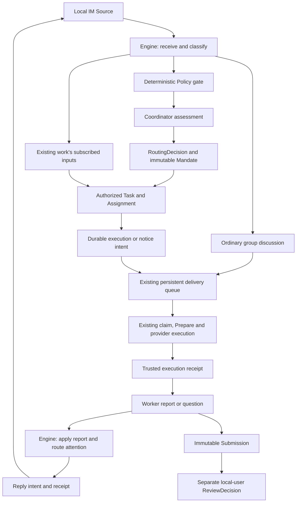

# Conversation-led orchestration

This is the target architecture selected on 2026-11-01. It is a migration contract, not a claim that every module below is implemented. The product remains a local, single-user IM with multiple groups, one Go process, SQLite, and the existing CLI adapters.

The principal reference is [dsh-superagent-prototype at 6337fc8](https://github.com/deepseek-ai/dsh-superagent-prototype/tree/6337fc823ce20251c8de8085948165c81aaa701e). Its implementation provides a domain Engine, versioned admission policy, durable effects, persistent worker inputs, and source-specific replies. Its underlying Sessions, Inbox, Jobs, and Subagents are services of DeepSeek Harness; this repository does not independently implement that runtime. Our Go application adapts the orchestration responsibilities instead of embedding the DSH plugin.

## Product and execution flow

The conversation is the primary interface. Ordinary discussion can produce an Agent Turn without creating a Task. A request becomes authorized work only through a recorded admission decision. Follow-ups for existing work stay with that work unless its executor hands them back.

The initial Source and Channel are the local IM. GitHub and Feishu adapters may later implement the same contracts; adding their descriptions or UI labels does not enable them or authorize external messages.

## Domain mapping

| Reference concept | Go application meaning | Required distinction |
| --- | --- | --- |
| Source / Trigger | A source-owned immutable event and its verified metadata; local message events reference the existing Message | A Trigger can also be a command or system fact. Do not duplicate message text or infer identity from its body. |
| Thread | Shared discussion scope, identified by group and topic | Existing Conversation is private to one group/member/topic. It is not the shared Thread. |
| Channel | The destination for an authorized reply | A Channel is not a Pi/Codex provider or a model. |
| Policy / Eval | Deterministic eligibility followed by a version-bound assessment of one Thread batch | Model judgment cannot bypass the gate, choose the caller, or grant permissions. |
| Decision / Mandate | RoutingDecision plus immutable authority, origin, scope, strength, and policy revision | RoutingDecision is not the existing deliverable ReviewDecision. Scope text is not a filesystem grant. |
| Ticket | An existing Task with explicit coordination and Mandate records | An ordinary or manually recorded Task does not automatically authorize execution. Do not create a second unrelated task system. |
| Assignment | A durable executor binding for authorized work, independent of physical Turns | Current TaskAttempt is an immutable generation/evidence association, often bound to one Turn. It must not silently become a multi-turn Assignment. |
| Subscription / Input | Work-to-Thread follow-up ownership and durable inputs | A subscription supplies context, not wider authority. Delivery remains the physical member-conversation delivery record. |
| Report / Attention | Structured progress, outcome, or one concrete question | A report of readiness creates or points to a Submission; it never accepts its own result. |
| Effect / Outbox | A durable intent and its independently tracked reply receipt | An intent is not proof of execution or external delivery. |

Each group has an isolated coordinator identity and its own execution conversations. A coordinator is a server-bound role, not a member name or free-form responsibility string. This adapts the reference's one-repository main Session to multiple isolated groups. Worker roles remain bound to their Assignment and live execution scope.

An Assignment may eventually span multiple Turns. That requires an explicit, reviewed association and generation check. Existing same-Turn submission fences continue to apply until that association is implemented; no adapter may weaken them merely to obtain continuity.

## Modules and their interfaces

Runtime is the composition root. It owns the process lock, Store, private roots, adapters, HTTP, startup, and ordered shutdown. It contains no admission rules.

Engine is the only writer of the new coordination aggregates. Its small role-scoped interfaces receive commands and adapter facts. Intake, admission, follow-up ownership, work transitions, and replies are internal parts of the same module, rather than parallel orchestration services.

| Caller | Interface responsibilities |
| --- | --- |
| Verified Source | Receive a source event, associate its Threads, report an external close |
| Local user | Explicitly request or attach work, stop authorized work, resolve an attention request, review a concrete Submission |
| Bound coordinator | Assess a current candidate, record a permitted decision, route work or a follow-up, send an allowed reply |
| Bound worker | Report on its Assignment, acknowledge only evidenced inputs, submit a deliverable, request help, hand back an unrelated follow-up |
| Runtime adapter | Report start, input delivery, terminal receipts, and reconciliation facts for its bound execution generation |

The Store supplies a transactional seam through which one Engine command changes all affected records and queues its intents. Extract and reuse existing in-transaction helpers; do not call public Store operations that open a second transaction from inside an Engine transaction. File copies, model calls, native process launches, and network writes happen after commit.

Policy is deterministic and versioned. Assessment proposes a decision under a captured Policy revision and candidate generation. A stale result cannot accept work after either changes. Explicit local-user requests are supported first. Inferred work begins in observation mode and requires an enabled written rule before automatic execution.

A trusted Policy change invalidates stale evaluations and notifies the work it affects. An ended Task's coordination may resume only after its original Mandate is revalidated against the current Policy. A human stop persistently withdraws that Mandate: ordinary follow-up, attach, or retry cannot restore it; newly authorized work requires a new decision and Mandate. This authorization transition does not release an uncertain native Turn's resource claims.

Assessor and Executor are different responsibilities. The assessor decides whether and where work belongs. The executor uses the existing scheduler, claim fencing, provider adapters, and receipts to perform it. There is one persistent execution queue, not an additional scheduler hidden behind Engine.

## Persistence and recovery contracts

- Source event identity is stable and idempotent. Replaying an accepted event cannot create another Task, Mandate, Assignment, or acknowledgement.
- A Thread has at most one current evaluation generation. Events that arrive while assessment runs remain available for the next batch.
- Domain changes and their durable intents commit together. Workers run intents after commit with bounded scans and backoff. A generation comparison prevents an old completion from deleting a newer payload under the same effect key.
- Effects are at-least-once scheduling. Local replies reuse the existing message transaction and idempotency receipt. Any external Channel must supply its own idempotency or reconciliation behavior; the queue alone cannot promise external exactly-once delivery.
- Existing deliveries remain the source of execution scheduling. Effects may create a stable delivery or a coordinator notice; they must not launch a second CLI for an already claimed or uncertain delivery.
- Input queued, adapter accepted, demonstrably consumed, processed, and task accepted are distinct facts. Pi/Codex paths without trustworthy native-history evidence must not manufacture an input read receipt.
- Human follow-up ownership is explicit. Context-only subscriptions neither widen a Mandate nor resume stopped work. A worker can hand back a message, but another owner must not lose it as a side effect.
- A structured question is a single attention record with a stable identity. Routine progress updates do not wake every member or append repetitive IM notifications.

All migrations remain append-only. Existing durable messages, idempotency receipts, Task versions, artifact references, and claim evidence are retained. Timestamp/ID cursors remain display pagination; a durable message sequence, where available, is the basis for commit-position processing. No cursor is silently reinterpreted as another kind of acknowledgement.

## Safety and compatibility retained from this application

The reference is research code. Its product-specific choices do not replace these established contracts:

1. A business stop requests cancellation; it does not prove that a native process or background operation stopped. Unknown and cancel-requested executions retain capacity and resource claims until an authoritative terminal or reconciliation receipt.
2. Restart does not blindly create a replacement execution for an uncertain start. A new Assignment or a recovery prompt cannot erase old external uncertainty.
3. Task submission and acceptance remain separate. Worker readiness, a merged external Thread, native exit zero, or an ended Assignment cannot fabricate a local-user ReviewDecision.
4. Group isolation, runtime-bound tool identity, same-transaction authorization fences, and explicit resource grants remain mandatory. Prompt scope is explanatory text, not an operating-system sandbox.
5. CLI credentials remain with their original CLI. Installation, account state, connectivity, and supported capabilities remain independent evidence. A stable platform Session identifier does not imply native resume, steering, or compaction support.
6. Bounded event/frame queues, SQL range scans, shutdown drain, and the existing skills allocation regression gate are preserved. No per-native-event durable-effect fan-out or unbounded history scan is introduced.

In particular, do not adopt the reference's timeout-based worker-slot release while background subagents may still run, or its automatic restart of interrupted work, as substitutes for this application's receipts.

## IM interaction contract

The UI uses a conversation list, a central chronological message timeline, and a composer that remains reachable. Members, Tasks, deliverables, search, and conversation details are contextual panels or drawers. They do not replace the conversation with a dashboard or a collection of administrative pages.

Use the existing charcoal, warm-white, and vermilion tokens. Display the local author as the user and a member by its real known identity. Put technical identifiers and detailed execution evidence in expandable details. Keep source identity separate from the selected Agent provider.

Panel or conversation changes must preserve pending and uncertain mutations, their original input, and their idempotency keys. Hidden, unused reads may stop; shared roster data still needed by the active composer must remain available. Closing a panel must not cancel a submitted write or change the chosen recipients.

Message visibility and wakeups stay separate: default routing, explicitly public-only, and explicitly selected recipients retain their existing meanings. Textual mentions do not silently alter delivery. Receipts distinguish saved, accepted by the CLI, terminal, submitted, and accepted result; no unproven read or typing indicator is shown.

Task and attention cards require durable typed references and real actions. Their immutable event history is separate from any clearly labeled current-state projection. Until the backend supplies those references, show the actual Task in a contextual panel rather than inventing an event in the chat.

Unread counts, last-message previews, coordinator badges, external-source labels, and activity indicators require authoritative data. Responsive IM navigation must preserve drafts, scroll position where possible, keyboard focus, and unknown-result recovery across conversation list, chat, and details views.

## Incremental acceptance

1. Deliver the IM shell on the existing working message flow, with desktop, short-window, narrow-screen, keyboard, and delayed-response validation.
2. Add the local Source, immutable event references, recorded admission, and Mandate-backed Task coordination through one Engine. Explicit work admission is the first executable path.
3. Add durable coordination effects, executor bindings, follow-up ownership, and structured reports using the existing queue and receipts.
4. Verify a real coordinator and worker conversation, including follow-up during execution, an attention question, explicit deliverable review, controlled restart, and unknown-outcome protection.
5. Extend provider continuity and external Sources one adapter at a time, only after their actual capabilities and authority are verified.

Each slice is reviewed independently and tested through its module interface. A UI mockup, fixture, adapter smoke test, or merged PR alone does not establish the full workflow.

## Pinned design provenance

- [Domain model and rejected concepts](https://github.com/deepseek-ai/dsh-superagent-prototype/blob/6337fc823ce20251c8de8085948165c81aaa701e/docs/001-domain.md)
- [Engine and role interfaces](https://github.com/deepseek-ai/dsh-superagent-prototype/blob/6337fc823ce20251c8de8085948165c81aaa701e/src/core/engine.ts)
- [Transactional intake](https://github.com/deepseek-ai/dsh-superagent-prototype/blob/6337fc823ce20251c8de8085948165c81aaa701e/src/core/intake.ts)
- [Effects and generation fencing](https://github.com/deepseek-ai/dsh-superagent-prototype/blob/6337fc823ce20251c8de8085948165c81aaa701e/src/app/effects.ts)
- [Outbox receipts](https://github.com/deepseek-ai/dsh-superagent-prototype/blob/6337fc823ce20251c8de8085948165c81aaa701e/src/app/outbox.ts)
- [Persistent Session input delivery](https://github.com/deepseek-ai/dsh-superagent-prototype/blob/6337fc823ce20251c8de8085948165c81aaa701e/src/app/delivery.ts)
- [Executor and background lifecycle](https://github.com/deepseek-ai/dsh-superagent-prototype/blob/6337fc823ce20251c8de8085948165c81aaa701e/src/executor/dsh.ts)
- [Low-attention philosophy](https://github.com/deepseek-ai/dsh-superagent-prototype/blob/6337fc823ce20251c8de8085948165c81aaa701e/docs/000-philosophy.md)
- [The reference supervision panel](https://github.com/deepseek-ai/dsh-superagent-prototype/blob/6337fc823ce20251c8de8085948165c81aaa701e/docs/005-panel.md)

The reference is MIT licensed. Preserve its license and attribution when adapting implementation code. Source-specific defaults, account identities, repository paths, and deployment policy are not copied into this application.
