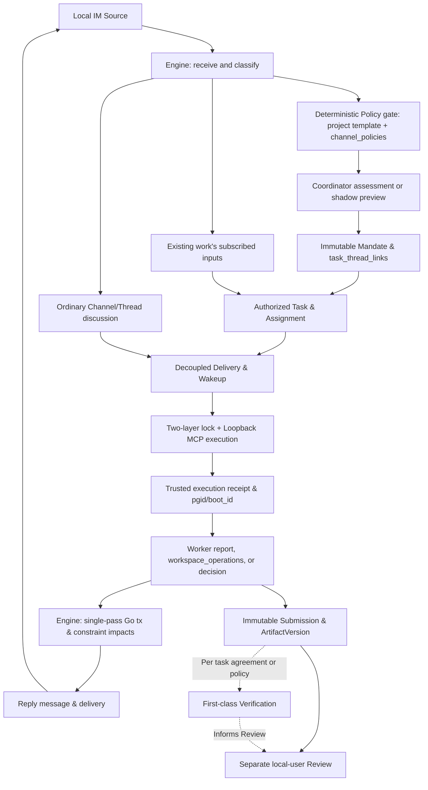

# Conversation-led orchestration

> **Status & Dual-State Notice**: This document defines the **sole target orchestration contract** for the converged 39-table `Workspace -> Project -> Channel` architecture ([architecture.md](architecture.md), [ADR-0001](adr/0001-architecture-convergence.md)). On current `origin/master` (`0188361`), live runtime code still executes the legacy `Group/Conversation` implementation until [architecture-convergence-roadmap.md](plans/architecture-convergence-roadmap.md) Phase 5 merges into `master`.

[PRD.md](../PRD.md) is the product authority. The orchestration Engine lives in one local Go process backed by SQLite WAL storage and unified Session-Bound Loopback MCP execution for `Pi >= 1.5.2` and `Codex >= 0.172.0`.

The principal reference is [dsh-superagent-prototype at 6337fc8](https://github.com/deepseek-ai/dsh-superagent-prototype/tree/6337fc823ce20251c8de8085948165c81aaa701e). Its implementation provides a domain Engine, versioned admission policy, durable effects, persistent worker inputs, and source-specific replies. Its underlying Sessions, Inbox, Jobs, and Subagents are services of DeepSeek Harness; this repository does not independently implement that runtime. Our Go application adapts the orchestration responsibilities into single-pass `BEGIN IMMEDIATE` Go transactions on the 39-table `target_v1` schema instead of embedding the DSH plugin.

## Product and execution flow

The conversation is the primary interface. Ordinary discussion in a Channel Thread can produce an Agent Turn without creating a Task. A request becomes authorized work only through a recorded admission decision (`Mandate`). Follow-ups for existing work stay with that work unless its executor hands them back (`task_work_inputs` with `status='returned'`).

Product CLI/model selection follows user configuration, task needs, verified adapter capabilities, and authorization. Permanent and temporary Agent responsibilities and collaboration are composed as needed without fixed model pairings. Testing, technical review, or independent verification (`verifications`) follows the task's acceptance agreement or a user-enabled `channel_policies` rule; pending verification alone does not bar rejection, while acceptance requires satisfying all agreed conditions.

The initial Source is the local IM. **Reply destination** means the authorized Channel and Thread response destination; GitHub and Feishu adapters may later implement the same contracts without altering core authorization boundaries.

## Policy tiers, handover, and crash reconciliation

1. **Three-tier Project policy & Channel/Thread overrides (`channel_policies`)**: `projects.default_policy_tier` defaults to `chat_only` (`read_only_collab` and `authorized_write` require explicit user selection). Channel-wide and Thread-scoped overrides live in `channel_policies` (protected by partial unique current-head and revision indexes), absorbing legacy coordinator bindings, dispatch allowlists, and policy revisions. Actions exceeding the active tier trigger an inline shadow preview card offering one-time or permanent Channel policy approval before proceeding.
2. **Direct natural-chat admission without scratchpads**: Explicit conversational requests (or enabled scoped preauthorizations) admit directly through the Engine in a single transaction, creating `tasks`, `task_thread_links` (M:N), immutable `mandates`, `assignments`, `deliveries`, and `wakeups` without intermediate assessment/candidate scratchpad tables.
3. **Temporary member departure & handover (`tasks.status = 'handover_pending'`)**: When a temporary `channel_members` row transitions to `status = 'left'`, active `assignments` transition to `cancelled` (retaining full assignment history), open Tasks freeze in `handover_pending`, and a `decisions(kind='handover')` item enters the user's global pending list (`POST /api/v1/me/decisions/{decision}/answer`), offering a one-click transfer suggestion when a Channel coordinator is bound, reassignment to another member, or Task cancellation (`tasks.status = 'cancelled'` with non-restorable `Mandate` revocation).
4. **In-flight constraint changes, lineage, and dependency rebinding**: Constraint-bearing `task_work_inputs` record owner consumption or explicit return (`returned`) and emit `task_constraint_impacts`, marking affected delegations, submissions, and downstream pinned `task_dependencies` stale. Rejection/repair and successor chains record immutable `task_lineage(kind IN ('repair','successor'))` provenance; downstream pinned `ArtifactVersion` dependencies never silently follow artifact heads and require explicit `local-user` approval (`POST /.../dependencies/{dep}/rebind` with `rebind_decision_id`) to rebind.
5. **Two-tier crash reconciliation (`POST /api/v1/projects/{project}/attempts/{attempt}/reconcile`)**: `turns` persists `external_pid`, `external_pgid`, `external_process_started_at`, and `external_boot_id` to defend against OS PID reuse (`412` mismatch keeps claims locked). Pure-text or read-only crashes with zero unresolved `workspace_operations` permit Tier 1 one-click lock release (`200`); crashes with `pending`, `unknown`, or `applied_sync_error` write operations return `428`, requiring preimage vs live disk SHA-256 comparison and explicit secondary confirmation (`200` + immutable `audit_events`) before releasing `resource_claims`.

## Domain mapping

| Reference concept | Go application meaning (`target_v1`) | Required distinction |
| --- | --- | --- |
| Source / Trigger | `messages` (`source_kind`, `command_source_id`) and verified source metadata | Never duplicate message text or infer user authority from message body text. |
| Thread | Shared discussion entity `threads` (`UNIQUE(project_id, channel_id, topic_key)`) | Distinct from `sessions` (per-member native execution context) and linked M:N to Tasks via `task_thread_links`. |
| Channel (DSH reference) | Authorized reply destination within a `Project` (`channels` + `threads`) | Distinct from provider adapters, models, and native `sessions`. |
| Policy / Eval | Deterministic `projects.default_policy_tier` + versioned `channel_policies` | Model assessment never bypasses Policy gates, chooses the caller, or grants filesystem access. |
| Decision / Mandate | Immutable `mandates` (incorporating routing reason & authority generation) | Distinct from deliverable `reviews` and directory `workspace_grants`. |
| Ticket | `tasks` (`open`/`handover_pending`/`submitted`/`accepted`/`cancelled`) | An un-mandated Task does not authorize execution; there is only one Task system. |
| Assignment | `assignments` (partial unique `WHERE status='active'` per Task) | Independent of individual `attempts` and physical `turns`; preserves handover history. |
| Subscription / Input | `task_work_inputs` + `task_constraint_impacts` + `task_thread_links` | Provides scoped context without expanding `Mandate` authority; decoupled from `deliveries` and `wakeups`. |
| Report / Attention | `submissions`, `verifications`, `decisions` (including `handover`), and `run_explanations` | Submission or Verification never substitutes for `local-user` `reviews` acceptance. |
| Effect / Outbox | `deliveries` + `wakeups` + `workspace_operations` + `audit_events` | Persistence or wakeup scheduling never fabricates CLI acceptance or terminal receipts. |

## Modules and their interfaces

Runtime is the composition root. It owns the process lock, SQLite writer/reader pools, private `0700` materialization directories, provider adapters, loopback HTTP/MCP server, startup, and ordered `wal_checkpoint(TRUNCATE)` shutdown. It contains no admission rules.

Engine is the single writer of coordination aggregates through small role-scoped interfaces inside single-pass `BEGIN IMMEDIATE` Go transactions (relying on SQL PK/composite-FK/CHECK constraints, 9 partial unique indexes, and 10 single-table immutability triggers — zero cross-table JOIN triggers):

| Caller | Interface responsibilities |
| --- | --- |
| Verified Source | Record message/source provenance, associate `threads` and `thread_state_revisions`, report external close |
| Local user | Request/attach work, cancel Tasks/revoke Mandates, resolve `decisions` (including `handover`), approve dependency `rebind`, execute tiered `reconcile`, submit `reviews` |
| Bound coordinator | Assess candidate work within active `channel_policies`, admit/route work or follow-ups, issue allowed channel replies |
| Bound worker | Report progress via Loopback MCP, consume or return `task_work_inputs`, perform claimed `workspace_operations`, publish `artifact_versions` & `submissions`, publish optional `run_explanations`, hand back unrelated follow-ups |
| Runtime adapter | Acquire/renew claims, bind `skill_snapshots` via `turn_skill_bindings`, record `pgid`/`boot_id` start proof, deliver receipts, classify terminal vs `unknown` outcomes |

File I/O, model invocations, native process launches, and network transport occur strictly outside SQLite transactions.

## Persistence and recovery contracts

- Source event identity and HTTP/MCP mutations share `idempotency_keys` (`operation, actor_id, scope_id, idempotency_key` + `payload_sha256`). Replaying an accepted key returns the original receipt; changed payload conflicts (`409`).
- Message persistence, recipient delivery acknowledgement (`deliveries.acked_at`), and model wakeups (`wakeups`) are persisted independently.
- Two-layer concurrency fences enforce at most one active `turn` per `session_id` and per `(project_id, channel_id, thread_id, member_id)`, plus exclusive `resource_claims` for mutable workspace writes held across `unknown` and `cancel_requested` states.
- `thread_state_revisions` (`is_head = 1` partial unique guard, `invalidates_revision`, `covered_through_sequence`) and `project_experiences` (with inline retirement provenance and replacement version) preserve cross-month handover accuracy without growing context windows on irrelevant message noise.
- Timestamps/ID cursors serve display pagination; committed `messages.sequence` and `workspace_operations.sequence` establish durable high-water marks.

## Atomic schema migration and rollback

Instead of multi-slice dual-track compatibility tables or append-only trigger growth, historical SQLite databases upgrade atomically in one shot:

1. **Pre-normalization**: Databases already at `user_version = 100` with `schema_meta.schema_family = 'target_v1'` pass idempotently with zero writes. Earlier `v1..v47` databases first upgrade to `v48` on a private temporary copy and verify `PRAGMA integrity_check == ok` and `PRAGMA foreign_key_check == 0`.
2. **Temp-file single transaction**: On the same filesystem mount, create `workspace.db.migrating.<nonce>` (`0600`), apply the 39-table `target_v1` DDL, and populate all 37 business tables, `schema_meta`, and `audit_events(schema_migrated)` in one `BEGIN IMMEDIATE` transaction.
3. **Four pre-rename gates**: Verify `PRAGMA integrity_check == ok`, `PRAGMA foreign_key_check == 0`, 100% SHA-256 content parity across all 37 business tables, and zero unaccounted non-empty `v48` source tables (`67` migrated + `33` explicitly retired = `100` source tables).
4. **Atomic cutover & zero-contamination rollback**: Checkpoint WAL (`TRUNCATE`), close, `fsync` temp file, remove stale `-wal`/`-shm`, `os.Rename` over `workspace.db`, and `fsync` data directory. Any failure deletes the temp file and leaves the original database byte-for-byte untouched.

## Safety and compatibility retained from this application

The reference is research code. Its product-specific choices do not replace these established contracts:

1. A business stop requests cancellation; it does not prove that a native process or background operation stopped. Unknown and `cancel_requested` executions retain capacity and `resource_claims` until an authoritative terminal or formal two-tier reconciliation receipt.
2. Restart does not blindly create a replacement execution for an uncertain start. A new Assignment or a recovery prompt cannot erase old external uncertainty.
3. Task submission and acceptance remain separate. Worker readiness, a merged external Thread, native exit zero, `verifications` outcome, or an ended Assignment cannot fabricate a `local-user` Review acceptance.
4. Project/Channel isolation, server-bound Loopback MCP identity (`-32602` forgery rejection), same-transaction authorization fences, and explicit `workspace_grants` / `artifact_read_grants` remain mandatory. Prompt scope is explanatory text, not an operating-system sandbox.
5. CLI credentials remain with their original CLI (`PI_CODING_AGENT_DIR` read-only symlink isolation for Pi; zero paid probes). Installation, account state, connectivity, and supported capabilities remain independent evidence. A stable platform Session identifier does not imply native resume, steering, or compaction support.
6. Bounded event/frame queues, indexed range scans, clean WAL `TRUNCATE` shutdown drain, and skills snapshot pinning (`turn_skill_bindings`) are preserved. No unbounded history scan is introduced.

In particular, do not adopt the reference's timeout-based worker-slot release while background subagents may still run, or its automatic restart of interrupted work, as substitutes for this application's receipts.

## IM interaction contract

The UI uses a left Project/Channel navigation list, a central chronological message timeline with selective quote/reply, and a persistent composer in the single `OpenbotShell`. Members, Tasks (`Verification` & dependency rebind), Channel policy (`ChannelPolicyPanel` & shadow preview), Pending Decisions (`PendingDecisions` including `handover`), Agent run logs, and two-tier crash reconciliation (`UnknownReconcilePanel`) are contextual views rather than administrative page replacements.

The everyday path is normal Channel conversation: Agents proactively respond and discuss within relevance, `channel_policies` bounds, and budget. When `local-user` confirms start in discussion, Engine evaluates trusted source and authority, creates the Task, immutable Mandate, Assignment, and wakeup within the intersection of the request/preauthorization and `workspace_grants`, and routes progress and deliverables back to the originating Channel/Thread without manual task-conversion forms or refreshes.

Preserve drafts, pending/uncertain mutations, and idempotency keys across Channel or panel switches; bind `@` and avatar right-click recipients to stable `member_id` values rather than display text; keep message visibility separated from wakeups; and expose server-proven states only.

## Convergence acceptance

Implementation proceeds through isolated worktrees along [architecture-convergence-roadmap.md](plans/architecture-convergence-roadmap.md) and merges to `master` only when all four release gates pass: (1) 5 historical samples lossless migration to 39 tables with zero silent drops; (2) zero `SQLITE_BUSY` across normal/`-race` concurrency and 5 DDL structural constraint proofs; (3) significant `-race` speedup calibrated against Phase 0 local per-package baseline with zero 600s timeouts; and (4) the single default startup profile (`127.0.0.1:7310`) passing all 6 real Playwright browser + dual CLI (`Pi >= 1.5.2`, `Codex >= 0.172.0`) end-to-end loops in [PRD.md](../PRD.md).

## Pinned design provenance

- [Domain model and rejected concepts](https://github.com/deepseek-ai/dsh-superagent-prototype/blob/6337fc823ce20251c8de8085948165c81aaa701e/docs/001-domain.md)
- [Engine and role interfaces](https://github.com/deepseek-ai/dsh-superagent-prototype/blob/6337fc823ce20251c8de8085948165c81aaa701e/src/core/engine.ts)
- [Transactional intake](https://github.com/deepseek-ai/dsh-superagent-prototype/blob/6337fc823ce20251c8de8085948165c81aaa701e/src/core/intake.ts)
- [Effects and generation fencing](https://github.com/deepseek-ai/dsh-superagent-prototype/blob/6337fc823ce20251c8de8085948165c81aaa701e/src/app/effects.ts)
- [Outbox receipts](https://github.com/deepseek-ai/dsh-superagent-prototype/blob/6337fc823ce20251c8de8085948165c81aaa701e/src/app/outbox.ts)
- [Persistent Session input delivery](https://github.com/deepseek-ai/dsh-superagent-prototype/blob/6337fc823ce20251c8de8085948165c81aaa701e/src/app/delivery.ts)
- [Executor and background lifecycle](https://github.com/deepseek-ai/dsh-superagent-prototype/blob/6337fc823ce20251c8de8085948165c81aaa701e/src/executor/dsh.ts)
- [Low-attention philosophy](https://github.com/deepseek-ai/dsh-superagent-prototype/blob/6337fc823ce20251c8de8085948165c81aaa701e/docs/000-philosophy.md)
- [The reference supervision panel](https://github.com/deepseek-ai/dsh-superagent-prototype/blob/6337fc823ce20251c8de8085948165c81aaa701e/docs/005-panel.md)

The reference is MIT licensed. Preserve its license and attribution when adapting implementation code. Source-specific defaults, account identities, repository paths, and deployment policy are not copied into this application.
