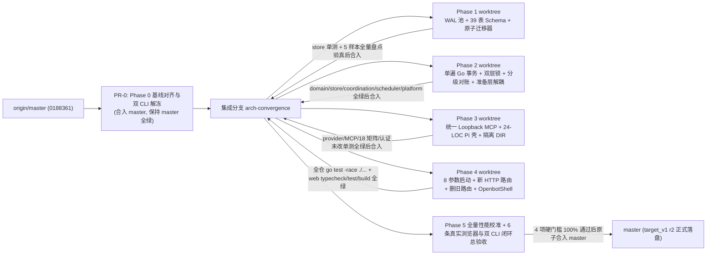

# 架构收敛 Phase 0–5 施工路线与验收门槛

> **过期与定位声明**：本文档仅作为架构收敛 **Phase 0–5 期间的临时施工路线与硬验收门槛清单**，不是长期产品或架构权威契约。长期目标契约与冻结依据见 [PRD](../../PRD.md)、[目标架构契约](../architecture.md)、[编排契约](../orchestration.md)、[提供方兼容性契约](../provider-compatibility.md) 与 [ADR-0001](../adr/0001-architecture-convergence.md)。架构收敛经 Phase 5 原子合入 `master` 后，本文档应归档或移除。
>
> **诚实双态声明**：截至基线 `origin/master`（`0188361`），主干当前实际运行代码仍为待替换的旧 `Group/Conversation` 实现、101 表 `v48` Schema 与双栈桥接层，尚未切至 39 表 `Project/Channel` 实现。

---

## 一、主干不断链集成策略

为避免直接替换 `internal/store` 导致主干 CI 在 Phase 1–3 连续编译失败，或引入第二套并行新包导致长期双轨维护，本次收敛采用**单一集成分支 `arch-convergence` + 子阶段独立 git worktree + Phase 4 全绿后经 Phase 5 原子合入 `master`** 策略：

- Phase 1–3 在 `arch-convergence` 上允许尚未触及的上层包暂不编入全仓构建，但必须划定各阶段包级验收范围。
- 每个子阶段须在独立 git worktree 推进，遵守 [AGENTS.md](../../AGENTS.md) 边界（不修改其他 worker 拥有路径，不提交 `.local/`、运行库或凭据）。

---

## 二、Phase 0–5 施工清单

| 阶段 | 前置依赖 | 主要编辑路径 | 核心交付与已冻结决策接线 | 机读验收命令与通过阈值 |
| --- | --- | --- | --- | --- |
| **Phase 0：基线对齐与双 CLI 解冻** | `origin/master`（`0188361`） | `internal/provider/`、`internal/store/native_session_pi.go`、`cmd/workspace/`、`web/src/` | 1. 从最新 `origin/master` 切出分支（偏好 3A）； 2. 移除精确补丁号硬锁改为按协议能力探测（支持 `Pi >= 1.5.2` 与 `Codex >= 0.172.0`）； 3. 删除实验性 `agy` 路径与死代码旧默认页模块； 4. 实测记录当前全仓逐包 normal 与 `-race` 耗时基线快照（供 Phase 5 校准） | `go test ./...` 退出码 `0`；全仓 Go/TS/HTML 源码检索不再存在旧精确补丁号白名单、实验性 `agy` 开关与已删死代码旧模块；零付费发现单测确认 `Pi >= 1.5.2` 与 `Codex >= 0.172.0` 就绪；基线 CSV 落盘于 `.local/progress/` |
| **Phase 1：SQLite WAL 池与 39 表原子迁移** | Phase 0 合入 `master` 后切 `arch-convergence` | `internal/store/` | 1. `store.Open` 切至 `WAL + synchronous=FULL + foreign_keys=1 + busy_timeout=5000 + wal_autocheckpoint=1000 + _txlock=immediate` + 写 1 / 读 4 池 + 退出 `wal_checkpoint(TRUNCATE)`，支持 `--sqlite-sync=full\|normal`（偏好 1B）； 2. 落地 39 表 `target_v1` DDL（`user_version=100, r2`）； 3. 落地 `v22/v33/v35/v48 -> target_v1` 临时文件单事务原子迁移器与 100 源表全量去向审计 | 5 样本迁移校验器退出码 `0`：`integrity_check=="ok"`、`fk==0`、`user_version==100`、`user_tables==39`、`triggers==10`、`join_triggers==0`、`views==0`、全部 37 张业务表 SHA-256 100% 匹配、`unaccounted_source_tables==[]`；5 组 DDL 结构约束单测全绿；故障注入原库 SHA-256 不变且残留临时文件 `== 0`；`go test -race ./internal/store/...` `SQLITE_BUSY==0` |
| **Phase 2：单遍 Go 事务、双层锁、分级对账与准备层解耦** | Phase 1 合入 `arch-convergence` | `internal/domain/`、`internal/store/`、`internal/coordination/`、`internal/scheduler/`、`internal/platform/` | 1. 全部写路径收敛为单遍 `BEGIN IMMEDIATE` Go 事务，删除重复 mega-SQL； 2. 编排器强制活跃轮次互斥 + 可变写排他 `resource_claims`； 3. 落地 `external_pid`/`external_pgid`/`external_process_started_at`/`external_boot_id` 采集与决策 1C 分级对账； 4. 落地决策 3C 临时成员退出冻结 `handover_pending` + 交接 `decisions`； 5. 落地依赖钉选人类改绑、任务取消/撤权不可恢复与聊天准备层对旧评估草稿表的彻底解耦 | `go test -race ./internal/domain/... ./internal/store/... ./internal/coordination/... ./internal/scheduler/... ./internal/platform/...` 退出码 `0`、`SQLITE_BUSY==0`；16 并发 barrier 竞态精确 `1 winner / 15 rejected`；真实 Pi/Codex `SIGKILL` 进程组对账通过（错误 `boot_id` 拒斥 `412`、Tier 1 `200`、Tier 2 未确认 `428` -> 哈希确认 `200`、`manual_sqlite_edits==0`）；自然聊天续办在零旧准入草稿表行下通过 |
| **Phase 3：统一 Loopback MCP 与 24-LOC Pi 壳** | Phase 2 合入 `arch-convergence` | `internal/provider/`、`internal/httpapi/member_tools*`、`extensions/`、`cmd/workspace/testdata/` | 1. `POST /api/v1/member-tools/mcp`（Streamable HTTP `2025-06-18`）补齐全部协作工具（含 `propose_task_decision`、`delegate_work`、`handback_work`、`publish_run_explanation`、`load_skill` 快照绑定）； 2. 上线预绑定 `-32602` 伪造拒斥、显式 session 级 `idempotency_key` 与 write-unknown 熔断； 3. `//go:embed` 内嵌 24-LOC `pi_thin_mcp.mjs`（`-e builtin:mcp` 去 `--no-mcp`），删除整个 `extensions/pi-bridge/`（含其包内文档）、`cmd/workspace/testdata/` 旧桥夹具及 21 条旧路由； 4. 落地偏好 2B 临时只读 `PI_CODING_AGENT_DIR` 隔离 | `extensions/pi-bridge` 不存在；单测证明临时 `PI_CODING_AGENT_DIR` 符号链接隔离在运行前后原 `~/.pi/agent/auth.json` 等文件 mtime/SHA-256 零变动；实机 Pi 1.5.2 与 Codex 0.172.0 5/5 工具类全通；断 TCP 换 id 重放 `duplicate_rows==0 && receipt_identical==true`；18/18 伪造矩阵 `escalations==0 && cross_project_leaks==0` |
| **Phase 4：8 参数启动、新路由、删旧路由与前端单壳** | Phase 3 合入 `arch-convergence` | `cmd/workspace/`、`internal/httpapi/`、`web/src/`、`docs/group-background-dispatch-preview.md` | 1. `cmd/workspace` 收敛为 8 参数单一默认启动档案（`--listen` 默认 `127.0.0.1:7310`，含 `--sqlite-sync=full\|normal`），同步删除旧预览存根 `docs/group-background-dispatch-preview.md`； 2. 上线完整 `/api/v1/projects/{project}/channels/{channel}/*` 与 `/policy`、`/reconcile`、`/rebind` 路由，**同波次彻底删除全部旧群组路由、兼容 DTO 与对应旧测试**（决策 4A）； 3. 单壳 `OpenbotShell` 移除旧经典兼容布局回退分支并接入项目三档模板、频道策略覆盖与影子预览（决策 2C）、分级对账面板（决策 1C）、临时成员交接卡片（决策 3C）与 `Verification` 视图 | `workspace --help` 仅输出 8 个运维参数且默认 `127.0.0.1:7310`；全仓 Go/TS/HTML 源码检索零残留旧群组 API 路径与旧经典布局回退入口；**全仓** `go test -race ./...` 与 `cd web && npm run typecheck && npm test && npm run build` 均退出码 `0`；跨项目/跨频道隔离 `409/404/403` 零泄漏 |
| **Phase 5：性能校准与 6 条真实闭环总验收** | Phase 4 全绿 | 验证脚本与发布回执（`.local/progress/`） | 1. 运行全仓 Go normal + `-race` 采集逐包耗时对比 `2026-11-26` CI 基线与 Phase 0 本地基线； 2. 仅以默认启动档案启动真实进程（默认端口 `127.0.0.1:7310`）+ 真实浏览器（Playwright）+ 真实 Pi 1.5.2 / Codex 0.172.0 跑通全部 6 条端到端闭环； 3. 生成发布机读总回执并原子合入 `master` | 全部 4 项硬验收门槛机读 JSON 断言 100% `passed`，`leaked_pids==[]` |

---

## 三、四项硬验收门槛量化锚定表

| 硬验收门槛 | 基准对照与实证来源 | 机读验收阈值（全部须同时满足） |
| --- | --- | --- |
| **门槛 1：历史无损升级（零静默丢行）** | 5 份 `.local/trial/` 历史样本（`v22`、`v33`、`v35`、`v48_successor`、`v48_producer`） | 5/5 样本升级后 `integrity_check == "ok"`、`foreign_key_check == 0`、`user_version == 100`、`user_tables == 39`、`triggers == 10`、`multi_table_join_triggers == 0`、`views == 0`、全部 37 张业务表 SHA-256 100% 匹配、`unaccounted_source_tables == []`、`unaccounted_source_rows == 0`；故障注入原库 SHA-256 100% 一致且残留临时文件 `== 0` |
| **门槛 2：零 `SQLITE_BUSY` 与结构约束等价** | 实验 1/2 并发基准（8 写并发 + 独立读池 + 16 并发 barrier）+ 实验 5 DDL 实证 | 常规与 `-race` 全量并发套件 `sqlite_busy == 0`、`unexpected_err == 0`、`data_race_detected == false`；活跃轮次唯一、指派交接部分唯一、撤权不可恢复等 5 组 DDL 约束测试 100% 通过 |
| **门槛 3：`-race` 耗时较基线显著下降（逐包实测校准）** | `2026-11-26` CI 基线（`internal/store` p50/p95 `123.04s/362.65s`，`internal/platform` `254.21s/568.24s`，`internal/httpapi` `84.19s/205.31s`，`cmd/workspace` `255.39s/536.22s`，Full CI 墙钟 `56m09s`）+ **Phase 0 同机实测逐包快照** | 鉴于实验 2 仅实测单条写路径（`-89.56%`），Phase 5 先以 Phase 0 同机逐包快照校准分包基线，同时执行硬底线： • 全仓所有包 `600s` 超时 `== 0`，无单测 `> 90s` • `internal/store` `-race` 较 `2026-11-26` CI 基线 p95 显著下降（目标 `<= 145s`，按 Phase 0 实测确认加速比显著 `p < 0.05`） • `internal/platform` / `internal/httpapi` / `cmd/workspace` `-race` 较基线显著下降且零新增回归 • 托管 Full CI 墙钟较 `56m09s` 显著下降（目标 `<= 25m`） |
| **门槛 4：单一默认启动档案跑通 6 条真实浏览器 + 双 CLI 闭环** | 仅传 `--data-dir` + `--web-dir`（默认 `--listen=127.0.0.1:7310`, `--sqlite-sync=full`）启动，真实 Playwright 浏览器 + 真实 Pi 1.5.2 & Codex 0.172.0（完整覆盖 [PRD](../../PRD.md) 全部核心场景） | 全部 6 条闭环 100% 通过且零人工改库： 1. 零成员频道拉预设与获准创员、只讨论接力、选择性引用回复（取消保留草稿、短摘跳原文、同消息引用加 `@` 合并 1 次投递）与全局侧边栏运行日志。 2. 普通聊天明确开工自动建 `Task/Mandate/Assignment/Attempt` 经统一 MCP 限域读写并发布版本成果至 `Verification` 与 `Review` 接纳回原频道（Pi 与 Codex 双通）。 3. 同群三项工作并行 + 中途补约束（`task_work_inputs` / `task_constraint_impacts`）+ 单项待决零催办 + 跨项目同名群决定精准回送。 4. 拒收修复（`task_lineage(kind='repair')`）+ 下游精确 `ArtifactVersion` 钉选与人类批准改绑 + 临时成员退出冻结 `handover_pending` 与一键转协调员或撤权取消。 5. 200 条噪音消息下的跨月换人接手（`thread_state_revisions` 有效约束 + `project_experiences` 停用出处 + 零噪音正文混入）。 6. 同目录双项目 `chat_only` 越级影子预览放行 + 跨项目隔离 `409/404/403` + 同 `cwd` 只读并发/写排他 + 伪造 `-32602` + 真实 Pi/Codex 进程组 `SIGKILL` 两级对账（`412`/`428`/`200`）。 |

---

## 四、留待实施阶段证明的真实运行项

以下真实环境运行项尚未在 `18d11a3` 研究期验证，须在对应实施阶段补充实测并归档回执：

1. 外接机械存储或非内置 SSD 卷与 Linux `ext4/xfs` 上的实际 WAL 写延迟对比（Phase 1 / Phase 5）。
2. 全仓 Go 包级 normal 与 `-race` 同机耗时基线（Phase 0 建基线、Phase 5 对比校准）。
3. 临时 `PI_CODING_AGENT_DIR` 符号链接隔离在真实 Pi `1.5.2` 运行前后对宿主机认证文件只读无副作用的单测（Phase 3）。
4. 单壳 `OpenbotShell` 与统一 `Project/Channel` 路由下 6 条真实 Playwright + 双 CLI 端到端闭环总验收（Phase 5）。
